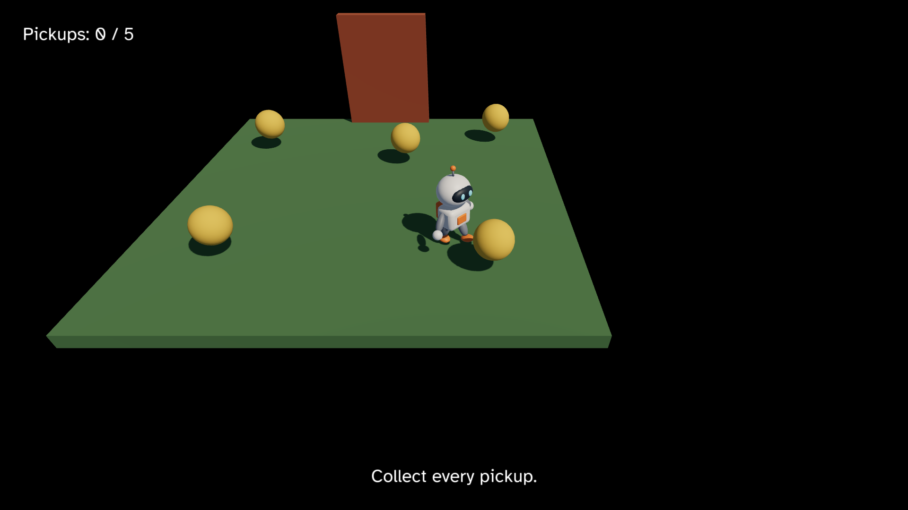

<h1 align="center">
  <picture>
    <source media="(prefers-color-scheme: dark)" srcset="docs/logo/rocco-wordmark-dark.svg">
    
  </picture>
</h1>

<p align="center">
  <a href="https://github.com/Pixelsprout/rocco-engine/releases/latest"></a>
  <a href="https://github.com/Pixelsprout/rocco-engine/actions/workflows/ci.yml"></a>
  <a href="https://pixelsprout.dev/projects/rocco/docs/"></a>
  <a href="LICENSE"></a>
</p>

## What is rocco?

rocco is an experimental 3D game engine for games written in
[Roc](https://www.roc-lang.org). You write the game as a few pure functions,
and an engine written in [Odin](https://odin-lang.org) runs the window, the
clock, the input, the GPU and the audio for you.

The engine is a Roc platform, and your game is a Roc app. One game builds for
macOS arm64, Linux x64, Windows x64 and the web.



## Warning

rocco is in the early stages of development. Important features are
missing, there is no physics, and a new release can break the API. Each
release pins one Roc nightly, and Roc itself changes from one nightly to the
next. Read [Is rocco right for you?](https://pixelsprout.dev/projects/rocco/docs/install/)
before you start a game with it.

## Design goals

- **Pure game code**: The game is a Model and five functions: `launch`,
  `init`, `step`, `loaded` and `view`. Roc never calls a draw function and
  never asks the engine a question in the middle of a step.
- **Facts in, decisions out**: The engine gives the game facts, such as the
  Input and the answers to its Queries. The game gives back decisions, such
  as the Scene and its Commands. Both cross as plain values.
- **One source, every target**: The same game builds for three desktops and
  the browser, with no platform flags in the game code.
- **Only Roc to make a game**: Each release ships the engine prebuilt, so a
  game author needs Roc and nothing else.
- **Easy to test**: A game's rules are plain functions that `roc test` can
  check, and [the Bridge](https://pixelsprout.dev/projects/rocco/docs/bridge/)
  lets a script or an agent play a running game.

## About

- **[Project page](https://pixelsprout.dev/projects/rocco/)**: An overview of
  rocco.
- **[Devlog](https://pixelsprout.dev/devlog/)**: Posts about progress, plans
  and new features.

## Docs

- **[Install and first run](https://pixelsprout.dev/projects/rocco/docs/install/)**:
  Install Roc, then build and run a first game from the release bundles. The
  best place to start.
- **[Tutorial](https://pixelsprout.dev/projects/rocco/docs/tutorial/)**: Build
  a small game with Pip in ten chapters, from an empty window to animation.
- **[Guides](https://pixelsprout.dev/projects/rocco/docs/)**: One page per
  topic, such as the Scene, input, sound, UI, collisions and web builds.
- **[API docs](https://pixelsprout.dev/projects/rocco/api/)**: The platform
  and the `camera`, `linalg`, `mesh` and `ui` packages, generated from the
  doc comments in this repo.
- **[Examples](examples/)**: Runnable games, among them one app for each
  tutorial chapter.
- **[Design](docs/DESIGN.md)** and **[Roadmap](docs/ROADMAP.md)**: Where the
  line between Odin and Roc goes and why, and what is built next.

## Community

- **[Roc Zulip](https://roc.zulipchat.com)**: The Roc community's chat. A good
  place for questions about Roc and about writing games in it.
- **[GitHub Issues](https://github.com/Pixelsprout/rocco-engine/issues)**:
  Bug reports and feature requests for rocco.

### Similar projects

- **[roc-ray](https://github.com/lukewilliamboswell/roc-ray)**: A Roc platform
  for graphics and simple games.

### Contributing

To build the engine from source, run its tests or learn how CI and releases
work, read [CONTRIBUTING.md](CONTRIBUTING.md).

## Getting started

Follow [Install and first run](https://pixelsprout.dev/projects/rocco/docs/install/)
to make a game with only Roc installed.

A game is a Roc app with five functions. This is the first tutorial chapter,
which draws a lit cube:

```roc
launch : Vocabulary.Config -> Vocabulary.Launch
launch = |_config| { ..Launch.default, window: { ..Launch.default.window, title: "Pip" } }

init : Vocabulary.Config -> { model : Model, commands : List(Command) }
init = |_config| { model: { cube: Mesh.primitive(Cube) }, commands: [] }

loaded : Model, Str, Manifest -> Model
loaded = |model, _pack, _manifest| model

step : Model, Vocabulary.Input, Vocabulary.QueryResults, F32 -> { model : Model, commands : List(Command) }
step = |model, _input, _results, _dt| { model, commands: [] }

view : Model -> Vocabulary.Scene
view = |model| {
	cube = { ..Draw.default, id: 1, mesh: model.cube, tint: { r: 0.9, g: 0.22, b: 0.03 } }
	camera = Cam.look_at({ x: 2.0, y: 2.0, z: 4.0 }, { x: 0.0, y: 0.0, z: 0.0 })
	{ ..Scene.empty, camera, nodes: [Light(sky_light), Light(sunlight), Draw(cube)] }
}
```

The full file is
[examples/tutorial/01-window/main.roc](examples/tutorial/01-window/main.roc).

## Licence

rocco is licensed under the Universal Permissive License 1.0 (UPL-1.0). See
[LICENSE](LICENSE).
