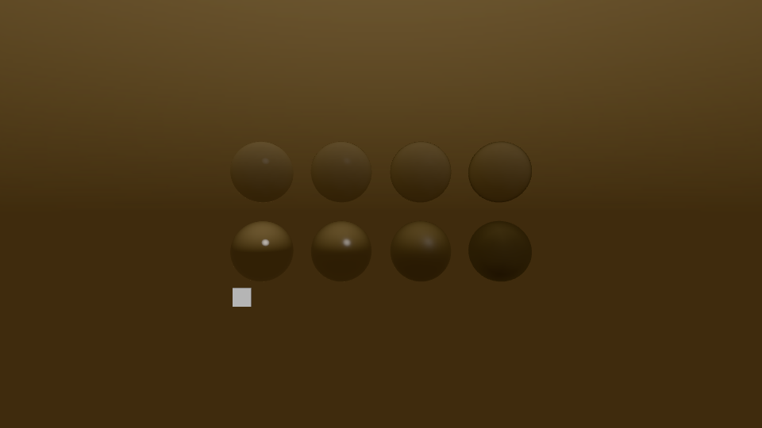
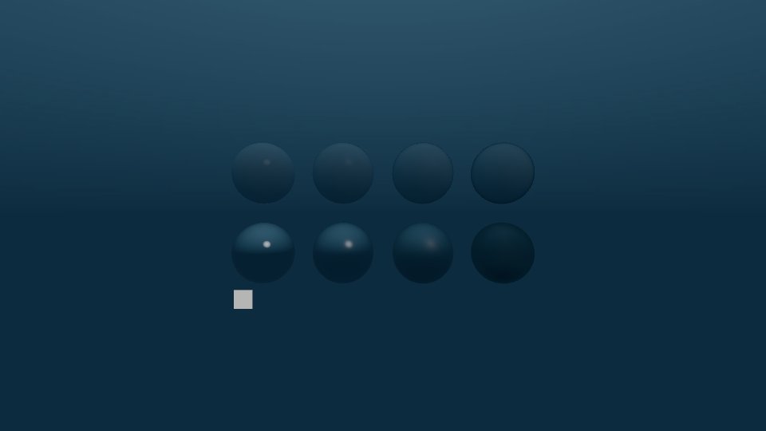

# Environment lighting evidence

Date: 2026-11-05.
The implementation uses the [documented lighting contract](ENVIRONMENT-LIGHTING.md).
The [numeric evidence](evidence/environment-lighting-2026-11-05.json) records all measured runs.





Roughness increases from left to right: 0.05, 0.25, 0.5, and 1.
The white square uses an unlit material.
The scene contains no direct or Ambient lights.

## Correctness

All 780 engine tests passed with native Bridge sockets enabled.
The tests include constant radiance, cube orientation, roughness spread, ownership cleanup, and full-resolution loading.
A 1024-face Sky loads without consuming the fixed 64 MiB Frame arena.
Standalone Image loads also release their temporary decode memory after each load.
The existing Pack tests check shared references and missing Sky faces.
The frame test selects one Sky for both environment lighting and background rendering before surface submission.

The [Bridge image check](evidence/environment-metal-images.json) passed on Metal.
Both dielectric and metallic rows follow the cubemap colour.
The unlit reference retains its colour when the cubemap changes.
Exposure affects the reference through the shared tone-map pass.
An absent or unloaded Sky removes both background and environment lighting.
A reload reproduces the original screenshot exactly.
The roughness check requires a decreasing reflection peak across the metallic row.

The published shader compiler tests and built-in shader generator tests passed: 17 tests.
All shaders cross-compile for Metal, GL 4.3, and D3D11.
The [production native proof](evidence/environment-native-metal.json) created, bound, and drew eleven shader variants on Metal.
Both environment inputs use actual RGBA16F cube views in that proof.
The wrapper keeps its Sun comparison sample before the hook-controlled unlit branch.
The native GL and D3D image checks remain pending CI.
The CI jobs now run the same environment image check and retain its screenshots.

## Integration checks

The integration retains `Vertex.world_position`, `Vertex.world_origin`, and the benchmark casting fields.
Both full engine modes passed 780 tests with vet and strict style checks.
The compiler, package, helper, and release checks passed 50 tests.
The public Metal proof passed all eleven variants with the thirteen-attribute layout and two instance records.
GPU readbacks verified world inputs and both outline occlusion policies.
Built-in and published material blocks match at 96 bytes, and lighting blocks match at 512 bytes.
Environment image checks covered colour response, roughness, unlit surfaces, exposure, missing skies, unload, and exact reload recovery.
The agent inspected the warm and cool images.
Both native processes exited successfully without graphics errors.
The integration artifacts are in `/tmp/rocco-env-merged/`.
Each CI backend retains one production proof and the existing cluster fixture.
Native GL and D3D11 environment results remain CI gates.

## Preparation cost

The CPU filter prepared a 256-face source five times under `taskpolicy -a`.
The release Odin build used speed optimization.
The measured times were 99.935, 95.769, 99.092, 99.589, and 100.135 ms.
The median was 99.589 ms.
Each prepared resource set contains 1,060,848 logical lighting bytes.
This measurement excludes PNG decode, file IO, and GPU upload.
Runtime Sky changes among loaded resources require no preparation.

## Frame cost

The machine used an Apple M5 with ten GPU cores and 16 GB RAM.
It used AC power with Low Power Mode off.
The main display ran at 144 Hz.
The reference used a verified 1920 by 1080 physical window and four-sample MSAA.
The host used release Odin optimization with Spans.
The Roc game used development compilation.
The scene used windowed Lockstep with one fixed step per Frame.
Other agents avoided heavy native work during the measurement window.

Each CPU mode used three fresh processes under `taskpolicy -a`.
Each process rendered 600 Frames.
The summary excludes the first 120 Frames and pools the remaining 1,440 Frames per mode.
CPU work sums the recorded work spans and excludes the timer-cost estimate.
Percentiles use the nearest-rank method.

| CPU frame work | Median | p95 | p99 | Maximum |
| --- | --- | --- | --- | --- |
| Environment enabled | 0.096 ms | 0.427 ms | 0.460 ms | 0.493 ms |
| Environment absent | 0.086 ms | 0.429 ms | 0.450 ms | 0.510 ms |

CPU process medians varied from 0.058 to 0.296 ms with the environment enabled.
The absent mode varied from 0.070 to 0.277 ms.
These measurements do not establish a small CPU cost difference.

Each GPU mode used one separate Metal System Trace capture with 600 Frames.
The summary excludes the first 120 Frames.
It unions Active Metal intervals for the reference process within each GPU frame.
It excludes other processes and overlapping intervals.
The profiler launched the game directly.
It did not force the CPU application policy used for the separate CPU measurements.

| GPU active time | Median | p95 | p99 | Maximum |
| --- | --- | --- | --- | --- |
| Environment enabled | 1.563 ms | 2.626 ms | 3.318 ms | 4.373 ms |
| Environment absent | 1.247 ms | 2.314 ms | 2.911 ms | 5.951 ms |

The observed p95 difference was 0.312 ms.
This comparison includes the background pass and surface lighting together.
It uses one GPU capture per mode.
The reference does not establish village performance or real-clock frame pacing.
The PC reference run remains a separate gate.

## Desktop backend validation

[CI run 41963156762](https://github.com/Pixelsprout/rocco-engine/actions/runs/41963156762) passed all jobs.
The native environment image checks passed on Metal, GL, and D3D11.
They cover warm and cool lighting, roughness, exposure, absent resources, unload, and reload.
The four reported roughness peaks matched across backends: 177.7, 137.3, 71.7, and 39.0.
The agent inspected the Windows warm-lighting capture and found no rendering failure.
These checks validate the environment feature, not final village performance.

## Reproduce the measurements

Build the host with `roc scripts/build.roc host --release --spans`.
Build the reference with `roc scripts/build.roc game environment-lighting`.
Run each CPU process from `examples/environment-lighting`:

```sh
ROCCO_LOCKSTEP=1 ROCCO_EXIT_AFTER_FRAMES=600 ROCCO_SPANS_CSV=/tmp/environment-on.csv \
  taskpolicy -a ./environment-lighting.bin --1080
ROCCO_LOCKSTEP=1 ROCCO_EXIT_AFTER_FRAMES=600 ROCCO_SPANS_CSV=/tmp/environment-none.csv \
  taskpolicy -a ./environment-lighting.bin --1080 --none
```

Use separate processes for each repetition.
Run the GPU captures sequentially:

```sh
xcrun xctrace record --template 'Metal System Trace' --time-limit 30s \
  --output /tmp/environment-on.trace --env ROCCO_LOCKSTEP=1 \
  --env ROCCO_EXIT_AFTER_FRAMES=600 --env ROCCO_SPANS_CSV=/tmp/environment-profile-on.csv \
  --launch -- ./environment-lighting.bin --1080
xcrun xctrace record --template 'Metal System Trace' --time-limit 30s \
  --output /tmp/environment-none.trace --env ROCCO_LOCKSTEP=1 \
  --env ROCCO_EXIT_AFTER_FRAMES=600 --env ROCCO_SPANS_CSV=/tmp/environment-profile-none.csv \
  --launch -- ./environment-lighting.bin --1080 --none
```

Export each trace's `metal-gpu-intervals` table with `xctrace export`.
Run `scripts/environment_gpu_summary.py` with `--discard 120` on each exported XML file.
The captured raw traces remain at `/tmp/cubemap-on.trace` and `/tmp/cubemap-none.trace`.
The Frame CSV files remain under `/tmp/rocco-cubemap-lighting/build/environment-perf/`.
