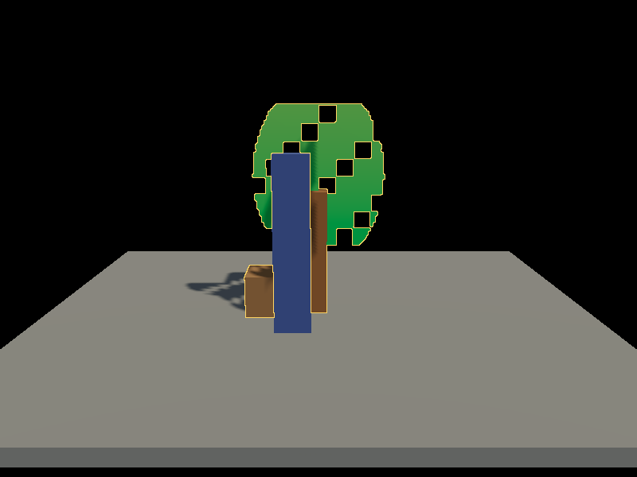
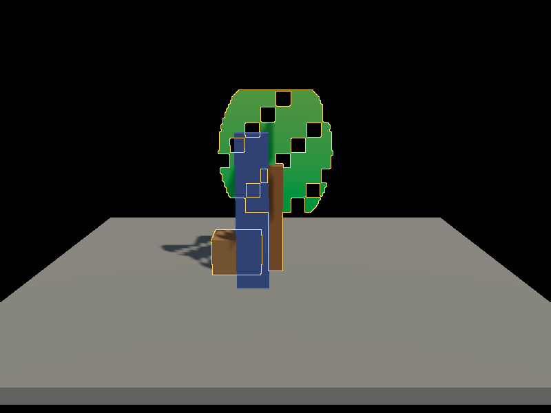
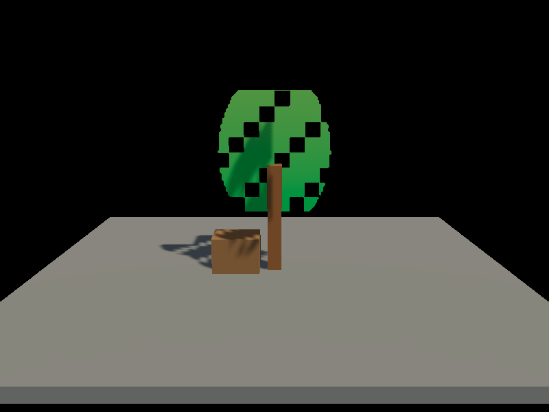
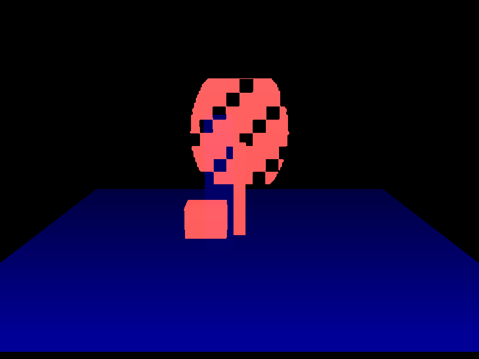

# External shader authoring proof

The small [authoring game](../examples/authoring/README.md) implements the required shader workflow.
The game contains a two-slot tree, ground, an occluder, and a selected Group.
The game owns the Surface hooks and both outline policies.
The candidate wind hook converts world displacement through the resolved inverse direction basis.
Its explicit local clamp preserves the declared displacement bound under small scales.

The local ordinary-release Metal run passed.
The clean published-candidate jobs remain the acceptance gate.
Keep full village integration blocked until all three candidate jobs pass.

| Evidence | Status |
| --- | --- |
| Local Metal preparation | Passed. |
| Local Mac SDK archive replay | Passed; unpublished. |
| Downloaded candidate SDK on Metal | Pending draft-PR CI. |
| Downloaded candidate SDK on GL 4.3 | Pending draft-PR CI. |
| Downloaded candidate SDK on D3D11 | Pending draft-PR CI. |
| Reference PC performance | Outside this compatibility proof. |

## Local evidence

The local host uses ordinary release settings.
The verification uses Odin `dev-2026-08-nightly:902106f` to build that host.
The standalone game and shader compiler use no Odin calls.
The [local evidence](evidence/shader-authoring/local-metal/evidence.json) records toolchain versions, package hashes, exact commands, and checks.
It records `local preparation` to distinguish this run from published-artifact evidence.
A second [local archive replay](evidence/shader-authoring/local-metal/bundle-replay.json) passed from an external folder with Odin absent.
That replay uses locally bundled Mac SDK archives.
It does not satisfy the published three-target candidate gate.

The [merged SDK replay](evidence/shader-authoring/merged-metal/sdk-replay.json) passed 169 checks with Odin absent.
The [merged checks](evidence/shader-authoring/merged-metal/summary.json) include the inverse direction input and Windows publication correction.
The candidate uses amplitude 0.2 so fixed steps do not reach the same 0.25 local clamp.
This replay remains unpublished.

The two frames use the same selected Group and scene.
The game changes only the Post shader's `visible_only` parameter.

The Selection image shows coverage in red, selected depth in green, and scene depth in blue.
The occluder does not remove selected coverage or selected depth.

## Candidate packaging

CI captures plain release targets before benchmarks enable Spans.
Linux checks finish with Spans, so CI rebuilds its plain release targets before capture.
The candidate job and stable release use the same explicit bundle helper.
The helper includes target inputs and every shader-tool dependency.
Roc does not discover these dependencies during bundling.

The `candidate-sdk` artifact contains:

- The platform archive.
- The `linalg`, `mesh`, `ui`, and `camera` package archives.
- The self-contained authoring fixture archive.
- `candidate.json` with the source commit, run, and Roc pin.
- `SHA256SUMS` for every archive and metadata file.

The candidate is a draft-PR CI artifact.
The workflow creates no release tag or stable release.
CI retains candidate artifacts for 14 days.
Download evidence before that retention period ends.

## Clean proof jobs

The three jobs start on fresh runners without checkout steps.
They install the Roc nightly from `candidate.json` through the builder's matching workflow output.
They record the compiler download URL and observed SHA-256 digest.
The SDK shader tool installs sokol-shdc from its pinned commit.
It verifies the compiler against the checksum in the SDK contract.

The jobs assert that Odin is absent before compilation and after the native run.
They assert that the fixture and extracted SDK contain no checkout or Odin source.
Windows clears `LIB` before linking.
Linux uses Xvfb and software Mesa.

Each job verifies candidate checksums before it extracts the fixture.
The proof verifies those checksums again before it runs `roc unbundle`.
It uses an explicit empty working directory for archive extraction.
Roc rejects release filename prefixes in its `unbundle` command.
The proof copies each verified archive to its bare hash name before extraction.
The evidence keeps the original published filename and digest.
It builds the game from the extracted platform and package archives.
The fixture supplies its own Bridge client and PNG reader.
It imports no repository verification tools or native engine harness.

Each backend uploads an `external-authoring-*` evidence artifact.
Its `evidence.json` records the actual candidate artifact URL, artifact ID, run, source commit, and archive digests.
It also records exact toolchain versions, build commands, run commands, native checks, and screenshots.
Manual SDK runs retain the `local SDK replay` label.
Only matching clean CI artifact provenance can set the published-artifact gate to passed.

## Required checks

The native proof checks these behaviours:

1. Repeat fixed Bridge steps and compare wind frames exactly.
2. Isolate shadow masks and verify moving cutout shadows.
3. Repeat Selection wind coverage with the same fixed steps.
4. Compile typed shader helpers and named `Bark` and `Leaves` helpers.
5. Preserve imported leaf colour, alpha texture, and the unassigned Bark material.
6. Remove tree shadow casting while preserving colour coverage.
7. Unload the Shader Pack while preserving the separate Mesh Pack.
8. Restore the Shader Pack and compare the restored frame.
9. Compare selected coverage and depth with and without the wall.
10. Switch outline policies while preserving the selected Group and scene.
11. Reject invalid first Surface and Post packages without substitute rendering.
12. Recover retained Pack requests after valid packages appear.
13. Reload compatible Surface and Post source changes live.
14. Reject invalid source with a failed ordinary asset build.
15. Preserve all published outputs and the valid frame after compilation failure.
16. Reject an incompatible asset contract during reload.
17. Restore valid source and packages without restarting.
18. Retain the old frame after an interface change.
19. Rebuild the game and accept the new interface after restart.

Reload checks wait for a complete `build.json` whose package hashes match.
They then poll the rendered frame until the expected generation appears.
Time elapsed alone does not establish reload completion.

Use the commands in the [fixture instructions](../examples/authoring/README.md) to reproduce the checks.
The [game shader guide](GAME-SHADERS.md) explains the author contract and watcher behaviour.
