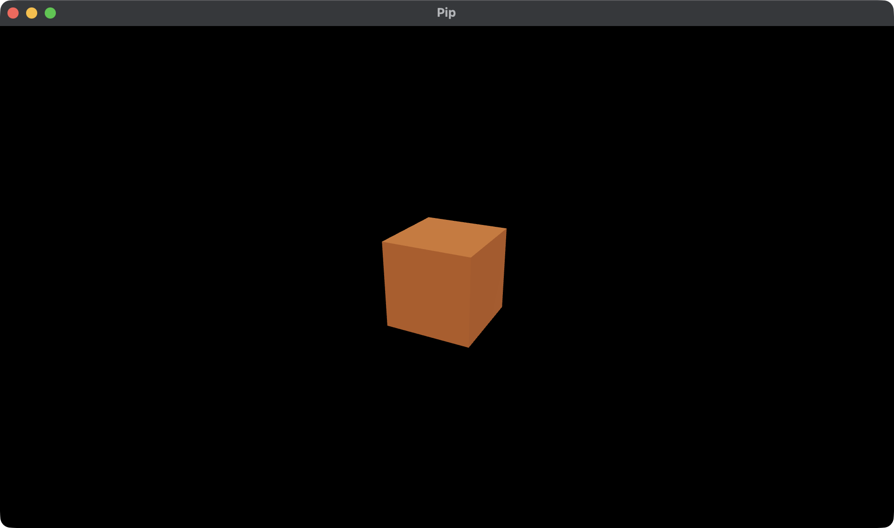

# 1. A window, a camera and a cube

In this tutorial, you make a small game. A robot with the name Pip walks on
the ground, collects pickups and opens a door. Each chapter adds one part
of the game and teaches the calls for it.

In this chapter, you open a window and draw a cube. You use three of the
[five calls](../calls.md):

- `launch` gives the window.
- `init` gives the first Model.
- `view` gives the Scene: the camera, the cube and the lights.



Each chapter has a full app in `examples/tutorial/`. This chapter is
[`examples/tutorial/01-window/main.roc`](../../examples/tutorial/01-window/main.roc).
If you get lost, compare your file with it.

## Before you start

Install Roc as [Install and first run](../install.md) tells. Use the Roc
nightly that the release names.

If you read this page on GitHub, the Roc nightly and the bundle URLs show as
markers in double braces. Get the values from the notes of the
[latest release](https://github.com/Pixelsprout/rocco-engine/releases/latest).

## Make the game folder

1. Make a folder with the name `pip`.
2. Make the file `pip/main.roc`.
3. Put this header at the top of `pip/main.roc`:

```roc
app [init, launch, loaded, step, view] { cam: "{{camera_url}}", mesh: "{{mesh_url}}", pf: platform "{{platform_url}}", roc: "{{roc_nightly}}" }
```

The header names the five calls and the bundles. `pf` is the rocco
platform. `mesh` gives the ids of the built-in meshes. `cam` points the
camera.

## Import the modules

Below the header, add the imports:

<!-- region: examples/tutorial/01-window/main.roc#imports -->
```roc
import cam.Camera as Cam
import mesh.Mesh as Mesh
import pf.Vocabulary exposing [Command, Manifest]
import pf.Draw
import pf.Launch
import pf.Light
import pf.Scene
```
<!-- endregion -->

`pf.Vocabulary` holds the types that pass between your game and the host.
`Draw`, `Launch`, `Light` and `Scene` give the records and the lights that
you start from.

## The Model

The Model is all of the state of your game. You declare its type. The host
holds the Model and never reads inside it.

<!-- region: examples/tutorial/01-window/main.roc#model -->
```roc
Model : { cube : U32 }
```
<!-- endregion -->

`cube` is a mesh id. A Draw gives the host a mesh id, not a mesh.

## launch

The host calls `launch` once, before it opens the window. Start from
`Launch.default` and set the window title:

<!-- region: examples/tutorial/01-window/main.roc#launch -->
```roc
launch : Vocabulary.Config -> Vocabulary.Launch
launch = |_config| { ..Launch.default, window: { ..Launch.default.window, title: "Pip" } }
```
<!-- endregion -->

The default window is 960 by 540. [Launch](../launch.md) tells about each
field.

## init

The host calls `init` once, after `launch`. It returns the first Model and a
list of Commands:

<!-- region: examples/tutorial/01-window/main.roc#init -->
```roc
init : Vocabulary.Config -> { model : Model, commands : List(Command) }
init = |_config| { model: { cube: Mesh.primitive(Cube) }, commands: [] }
```
<!-- endregion -->

The host makes three meshes itself: a cube, a sphere and a plane.
`Mesh.primitive(Cube)` gives the id of the cube. You need no file for it.

## loaded and step

The header names five calls, so the app must have all five. In this
chapter, `loaded` and `step` return the Model with no change:

<!-- region: examples/tutorial/01-window/main.roc#later -->
```roc
loaded : Model, Str, Manifest -> Model
loaded = |model, _pack, _manifest| model

step : Model, Vocabulary.Input, Vocabulary.QueryResults, F32 -> { model : Model, commands : List(Command) }
step = |model, _input, _results, _dt| { model, commands: [] }
```
<!-- endregion -->

Chapter 2 fills `loaded`. Chapter 3 fills `step`.

## view

The host calls `view` after each step. It returns the Scene, which tells
the host what to draw:

<!-- region: examples/tutorial/01-window/main.roc#view -->
```roc
lights : List(Vocabulary.Light)
lights = [
	Light.ambient({ r: 0.3, g: 0.3, b: 0.3 }),
	Light.directional({ x: -0.4, y: -0.8, z: -0.45 }, { r: 4.0, g: 4.0, b: 4.0 }),
]

view : Model -> Vocabulary.Scene
view = |model| {
	cube = { ..Draw.default, id: 1, mesh: model.cube, tint: { r: 0.9, g: 0.22, b: 0.03 } }
	camera = Cam.look_at({ x: 2.0, y: 2.0, z: 4.0 }, { x: 0.0, y: 0.0, z: 0.0 })
	{ ..Scene.empty, camera, draws: [cube], lights }
}
```
<!-- endregion -->

- The cube is a Draw. Start it from `Draw.default`, and set its `id`, its
  `mesh` and its `tint`. The cube is 1 unit wide, at the origin.
- `Cam.look_at` puts the eye at (2, 2, 4) and points it at the origin.
  `+y` is up.
- The host has no light of its own. With no lights, the cube is black. An
  ambient light lights each side a little. A directional light lights the
  sides that face it. Chapter 4 tells about lights.
- `Scene.empty` gives the other fields of the Scene.

## Run the game

In `pip/`, run:

```sh
roc main.roc
```

The first run downloads the bundles and builds the game. A window with the
title Pip opens and shows an orange cube. Close the window to stop the
game.

Next, read [2. The character](02-character.md). You load Pip from a file,
and the cube becomes the ground under it.
