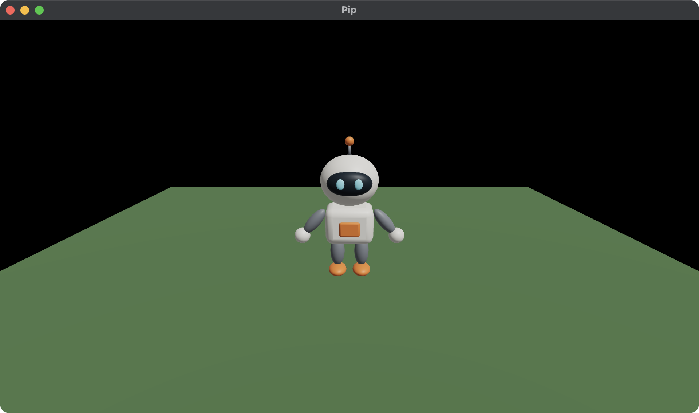

# 2. The character

In this chapter, you load Pip from a file and draw it on the ground. You
use:

- the `Load` Command, which loads the files of a Pack,
- the `loaded` call, which gets the mesh ids,
- the Manifest, which gives each name its id.



This chapter starts from your app from
[1. A window, a camera and a cube](01-window.md). The full app is
[`examples/tutorial/02-character/main.roc`](../../examples/tutorial/02-character/main.roc).
To see each change, compare the two chapter apps:

```sh
git diff --no-index examples/tutorial/01-window/main.roc examples/tutorial/02-character/main.roc
```

The header does not change:

```roc
app [init, launch, loaded, step, view] { cam: "{{camera_url}}", mesh: "{{mesh_url}}", pf: platform "{{platform_url}}", roc: "{{roc_nightly}}" }
```

## Get the mesh file

Pip is a binary glTF file, `pip.glb`.

1. Make the folder `pip/assets/meshes/`.
2. Download
   [`pip.glb`](../../examples/tutorial/02-character/assets/meshes/pip.glb?raw=true).
3. Put it in `pip/assets/meshes/`.

The host finds the `assets` folder beside `main.roc`. A mesh gets the name
of its file stem, so `pip.glb` is `pip`. [Assets and Packs](../assets.md)
tells where each kind of asset goes.

A Blender script makes Pip:
[`examples/tutorial/source/make_meshes.py`](../../examples/tutorial/source/make_meshes.py).

## The Model

Change the Model. The cube becomes the ground, and Pip gets its own mesh
id:

<!-- region: examples/tutorial/02-character/main.roc#model -->
```roc
# pip is 0, the fallback mesh, until loaded gives its id.
Model : { ground : U32, pip : U32 }
```
<!-- endregion -->

## Load the Pack

A Pack is a named set of assets that load together. Your game asks for a
Pack with the `Load` Command. Change `init`, and fill `loaded`:

<!-- region: examples/tutorial/02-character/main.roc#load -->
```roc
init : Vocabulary.Config -> { model : Model, commands : List(Command) }
init = |_config| {
	model = { ground: Mesh.primitive(Cube), pip: 0 }
	{ model, commands: [Load({ pack: "pip", assets: ["pip"] })] }
}

loaded : Model, Str, Manifest -> Model
loaded = |model, _pack, manifest| { ..model, pip: Mesh.resolve(manifest, "pip") }
```
<!-- endregion -->

The host runs the `Load` after `init` returns:

1. The host loads `pip.glb`.
2. The host calls `loaded` with the pack name `"pip"` and the Manifest.
3. The host calls `view` with the Model that `loaded` returned.

So the first `view` already has the id of Pip.

The Manifest is a list of each name that the `Load` asked for, with its
id. `Mesh.resolve` finds a name in the Manifest. Call it in `loaded`, and
keep the id in the Model. Do not look up a name in `view`.

If the file is not there, its name gets id 0. Id 0 is the fallback mesh, a
magenta cube. So a misspelt name shows on the screen, and the game does
not stop.

## view

Draw the cube as a flat ground, and draw Pip on it:

<!-- region: examples/tutorial/02-character/main.roc#view -->
```roc
view : Model -> Vocabulary.Scene
view = |model| {
	ground = { ..Draw.default, id: 1, mesh: model.ground, pos: { x: 0.0, y: -0.1, z: 0.0 }, scale: { x: 6.0, y: 0.2, z: 6.0 }, tint: { r: 0.12, g: 0.25, b: 0.1 } }
	pip = { ..Draw.default, id: 2, mesh: model.pip }
	camera = Cam.look_at({ x: 0.0, y: 1.4, z: 2.6 }, { x: 0.0, y: 0.5, z: 0.0 })
	{ ..Scene.empty, camera, draws: [ground, pip], lights }
}
```
<!-- endregion -->

- The ground is the cube, 6 units wide and 0.2 units high. Its top is at
  y 0.
- Pip stands on y 0 and faces `+z`, toward the camera. Pip is about 1.1
  units high. Its own colours come from the file, so it keeps the white
  tint of `Draw.default`.
- Each Draw has its own id. Keep the id of a thing the same from one step
  to the next. [The Scene](../scene.md) tells why.
- The camera moves nearer, and looks at the middle of Pip.

## Test the calls

Each call is a plain function, so `roc test` can test it. Add
`import pf.Config` below the other imports. `Config.empty` is a Config for
tests. Then add these tests at the bottom of the file:

<!-- region: examples/tutorial/02-character/main.roc#tests -->
```roc
expect init(Config.empty).commands == [Load({ pack: "pip", assets: ["pip"] })]

expect {
	model = loaded(init(Config.empty).model, "pip", [{ name: "pip", id: 4 }])
	model.pip == 4
}
```
<!-- endregion -->

The second test gives `loaded` a Manifest with id 4 for `pip`. Then it
makes sure that the Model keeps the id. Run the tests:

```sh
roc test main.roc
```

## Run the game

In `pip/`, run:

```sh
roc main.roc
```

Pip stands in the middle of a green ground. If you see a magenta cube,
make sure that the file is at `pip/assets/meshes/pip.glb`.

Next, read [3. Moving](03-moving.md). You make Pip walk with the keys.
