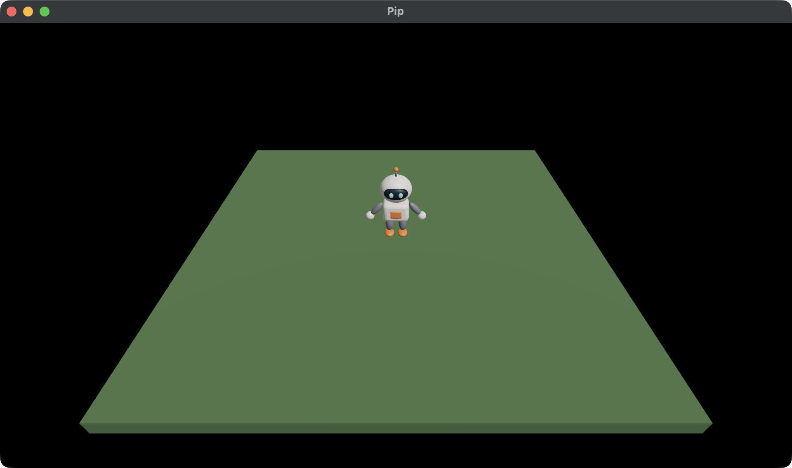

# 3. Moving

Pip stands still so far, because nothing changes the Model after `init`.
In this chapter, you make Pip walk with the keys W, A, S and D. You use:

- the `step` call, which gives the next Model at each fixed step,
- the Input, which tells you which keys are held and pressed.



This chapter starts from your app from [2. The character](02-character.md).
The full app is
[`examples/tutorial/03-moving/main.roc`](../../examples/tutorial/03-moving/main.roc).
To see every change, compare the two chapter apps:

```sh
git diff --no-index examples/tutorial/02-character/main.roc examples/tutorial/03-moving/main.roc
```

Keep `pip/assets/meshes/pip.glb` from chapter 2. It doesn't change.

## The header and the imports

Add the `linalg` package to the header. It gives you vectors and
rotations:

```roc
app [init, launch, loaded, step, view] { cam: "{{camera_url}}", linalg: "{{linalg_url}}", mesh: "{{mesh_url}}", pf: platform "{{platform_url}}", roc: "{{roc_nightly}}" }
```

Then change the imports to these:

<!-- region: examples/tutorial/03-moving/main.roc#imports -->
```roc
import cam.Camera as Cam
import linalg.Vec3 as V
import linalg.Quat
import mesh.Mesh as Mesh
import pf.Vocabulary exposing [Command, Manifest, Vec3]
import pf.Config
import pf.Draw
import pf.Input
import pf.Key
import pf.Launch
import pf.Light
import pf.QueryResults
import pf.Scene
```
<!-- endregion -->

`Key` reads the Input. `Input` and `QueryResults` give the empty values
that the tests use.

## The Model

Pip now needs a position and a yaw. Add them to the Model:

<!-- region: examples/tutorial/03-moving/main.roc#model -->
```roc
# pip is 0, the fallback mesh, until loaded gives its id.
# yaw turns Pip about +y. At 0, Pip faces +z.
Model : { ground : U32, pip : U32, pos : Vec3, yaw : F32 }
```
<!-- endregion -->

Pip starts at the origin with a yaw of 0:

<!-- region: examples/tutorial/03-moving/main.roc#init -->
```roc
init : Vocabulary.Config -> { model : Model, commands : List(Command) }
init = |_config| {
	model = { ground: Mesh.primitive(Cube), pip: 0, pos: V.zero, yaw: 0.0 }
	{ model, commands: [Load({ pack: "pip", assets: ["pip"] })] }
}
```
<!-- endregion -->

## step

The host calls `step` once for each fixed step, 120 times each second.
`step` gets the Model, the Input, the QueryResults and `dt`, the length of
one step in seconds. `dt` is the same at every step.

<!-- region: examples/tutorial/03-moving/main.roc#step -->
```roc
# Units each second.
speed : F32
speed = 2.5

# Pip stops this far from the centre, inside the edge of the ground.
edge : F32
edge = 2.7

step : Model, Vocabulary.Input, Vocabulary.QueryResults, F32 -> { model : Model, commands : List(Command) }
step = |model, input, _results, dt| { model: walk(model, input, dt), commands: [] }

# W moves away from the camera, toward -z.
walk : Model, Vocabulary.Input, F32 -> Model
walk = |model, input, dt| {
	dir = { x: Key.axis(input, A, D), y: 0.0, z: Key.axis(input, W, S) }
	if dir == V.zero {
		model
	} else {
		moved = V.add(model.pos, V.scale(V.normalize(dir), speed * dt))
		{ ..model, pos: { x: keep_on_ground(moved.x), y: 0.0, z: keep_on_ground(moved.z) }, yaw: F32.atan2({ x: dir.z, y: dir.x }) }
	}
}

keep_on_ground : F32 -> F32
keep_on_ground = |v| F32.max(-edge, F32.min(v, edge))
```
<!-- endregion -->

Here is what each part does:

- `Key.axis(input, A, D)` gives -1 while only A is held, 1 while only D
  is held, and 0 for neither or both. So `dir` points where the keys
  point.
- With no key held, `walk` returns the Model unchanged. Pip keeps its yaw,
  so it keeps facing the way it walked.
- `V.normalize` makes `dir` 1 unit long, so W and D together are no faster
  than W alone.
- Pip moves `speed * dt` in one step, so its speed in units each second
  doesn't depend on the step rate.
- `keep_on_ground` keeps Pip on the ground.
- The yaw turns Pip to face `dir`. A yaw turns `+z` to (sin, 0, cos), so
  the yaw of `dir` is `atan2(dir.x, dir.z)`. `F32.atan2` takes the two
  values as `y` and `x`.

Your game decides what each key means, because the host gives no key a
meaning. A key is held while it is down, and pressed only in the first
step after it went down. Walking uses held keys. [Input](../input.md)
covers held and pressed keys, and the mouse.

## view

Draw Pip at its position, turned by its yaw. Move the camera back, so that
you can see all of the ground:

<!-- region: examples/tutorial/03-moving/main.roc#view -->
```roc
view : Model -> Vocabulary.Scene
view = |model| {
	ground = { ..Draw.default, id: 1, mesh: model.ground, pos: { x: 0.0, y: -0.1, z: 0.0 }, scale: { x: 6.0, y: 0.2, z: 6.0 }, tint: { r: 0.12, g: 0.25, b: 0.1 } }
	pip = { ..Draw.default, id: 2, mesh: model.pip, pos: model.pos, rot: Quat.from_yaw(model.yaw) }
	camera = Cam.look_at({ x: 0.0, y: 3.6, z: 4.8 }, { x: 0.0, y: 0.0, z: 0.3 })
	{ ..Scene.empty, camera, draws: [ground, pip], lights }
}
```
<!-- endregion -->

`Quat.from_yaw` turns the yaw into the rotation that a Draw holds. Pip
keeps id 2 at every step, so the host pairs Pip's Draw across two Scenes
and moves Pip smoothly between them. [The Scene](../scene.md) explains how
this works.

## Test the movement

A test gives `step` an Input with some keys held. The Input holds key
codes, so make them with `Key.code`. Add these tests at the bottom of the
file, in place of the tests from chapter 2:

<!-- region: examples/tutorial/03-moving/main.roc#tests -->
```roc
pi : F32
pi = 3.14159265

near : F32, F32 -> Bool
near = |a, b| (a - b).abs() < 0.0001

start : Model
start = init(Config.empty).model

hold : List(Key.Key) -> Vocabulary.Input
hold = |keys| { ..Input.empty, held: keys.map(Key.code) }

# W for one step moves Pip toward -z and turns it to face -z.
expect {
	moved = step(start, hold([W]), QueryResults.empty, 0.1).model
	near(moved.pos.z, -0.25) and near(moved.pos.x, 0.0) and near(moved.yaw, pi)
}

# Two keys at once move Pip no faster than one key.
expect {
	moved = step(start, hold([W, D]), QueryResults.empty, 0.1).model
	near(V.length(moved.pos), 0.25)
}

# Pip stops at the edge of the ground.
expect {
	moved = step(start, hold([D]), QueryResults.empty, 10.0).model
	near(moved.pos.x, edge)
}

# With no key, Pip stays where it is and keeps its yaw.
expect {
	turned = { ..start, yaw: 1.0 }
	step(turned, Input.empty, QueryResults.empty, 0.1).model == turned
}
```
<!-- endregion -->

A test can pass any `dt`. A `dt` of 10 seconds would walk Pip far past the
edge in one step, so the third test checks that Pip stops at the edge. Run
the tests:

```sh
roc test main.roc
```

## Run the game

In `pip/`, run:

```sh
roc main.roc
```

Hold W, A, S or D. Pip walks and turns to face the way it walks, and stops
at the edge of the ground.

Next, read [4. Lights, a sun and its shadow](04-lights.md). You change the
lights, and Pip casts a shadow.
