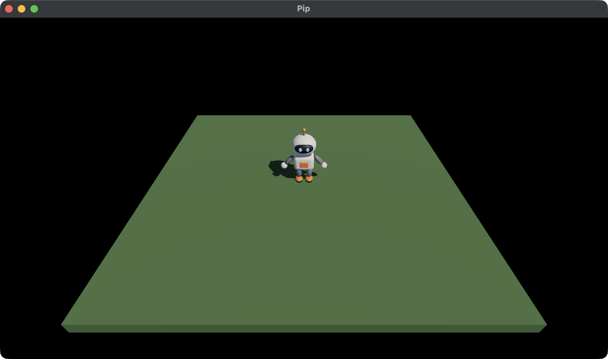

# 4. Lights, a sun and its shadow

Pip walks, but it looks pasted onto the ground, because nothing in the
game casts a shadow. A shadow shows where a thing stands. In this chapter,
you change the lights so that Pip casts one. You use:

- an ambient light, which lights every side a little,
- the sun, the one light that casts a shadow.



This chapter starts from your app from [3. Moving](03-moving.md). The full
app is
[`examples/tutorial/04-lights/main.roc`](../../examples/tutorial/04-lights/main.roc).
To see every change, compare the two chapter apps:

```sh
git diff --no-index examples/tutorial/03-moving/main.roc examples/tutorial/04-lights/main.roc
```

The imports and `pip.glb` stay the same, and so does the header:

```roc
app [init, launch, loaded, step, view] { cam: "{{camera_url}}", linalg: "{{linalg_url}}", mesh: "{{mesh_url}}", pf: platform "{{platform_url}}", roc: "{{roc_nightly}}" }
```

Only the lights change.

## The lights

Replace `sky_light` and `sunlight` with these two values:

<!-- region: examples/tutorial/04-lights/main.roc#lights -->
```roc
# A cool sky lights the sides that the sun misses.
sky_light : Vocabulary.Light
sky_light = Light.ambient({ r: 0.2, g: 0.25, b: 0.35 })

# The sun shines from behind the camera and to the right, so Pip's shadow falls
# behind it and to the left.
sunlight : Vocabulary.Light
sunlight = Light.sun({ x: -0.5, y: -0.75, z: -0.45 }, { r: 4.5, g: 4.0, b: 3.4 })
```
<!-- endregion -->

- `Light.ambient` lights every side of every mesh by the same amount. It
  has no direction, so it can't cast a shadow. A blue-grey colour makes
  the sides in shade look like they are lit by the sky.
- `Light.sun` makes a Directional light that casts a shadow. Its first
  value is the direction that the light travels, not where the sun is.
  This sun points down, away from the camera and to the left, so Pip's
  shadow falls behind it and to the left.
- The sun is a little yellow, so the lit sides look warm next to the cool
  shade.

A light's colour is linear and carries its strength, so a channel can go
above 1. The ambient light is dim, and the sun is bright.

Only one light casts a shadow: the first one in `nodes` that asks for it.
If a second Directional light asks for a shadow, it still lights the Scene,
but it casts no shadow, and the host logs a line. Use `Light.directional` for any other Directional light.

## The shadow map

The host draws the shadow from a shadow map: a picture of the Scene, seen
from the sun. The host fits the shadow map around every Draw in the Scene.
So when the Draws spread far apart, each pixel of the map covers more
ground, and the edges of the shadow get softer.

`Launch.default` makes a shadow map 2048 pixels wide. To change it, set
`shadow_map` in `launch`. A larger map gives sharper shadows and uses more
memory. A large world can set `shadow_cascades` to 4 instead, so shadows
near the camera stay sharp. [Launch](../launch.md) lists both fields.

## Run the game

The tests from chapter 3 still pass, because only the lights changed. In
`pip/`, run:

```sh
roc test main.roc
roc main.roc
```

Walk Pip around. Its shadow walks with it and falls on the ground behind
it.

Next, read [5. Pickups](05-pickups.md). You put pickups on the ground, and
Pip collects them.
