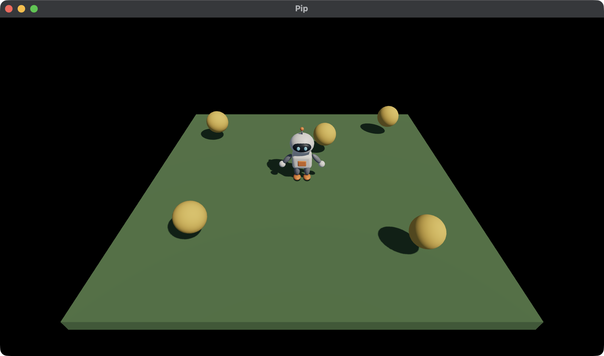

# 5. Pickups

Pip can walk, but it has nothing to do. In this chapter, you put five
pickups on the ground, and Pip collects each one that it touches. You use:

- Colliders, the shapes that the host can test,
- a `ContactsOf` Query, which asks which Colliders touch Pip,
- the Contacts, which the next `step` gets.



rocco has no physics. It moves nothing by itself. Instead, your game gives
the host shapes and questions, and the host gives back the answers. Your
game decides what the answers mean. [Collisions and Queries](../collisions.md)
explains this in more detail.

This chapter starts from your app from
[4. Lights, a sun and its shadow](04-lights.md). The full app is
[`examples/tutorial/05-pickups/main.roc`](../../examples/tutorial/05-pickups/main.roc).
To see every change, compare the two chapter apps:

```sh
git diff --no-index examples/tutorial/04-lights/main.roc examples/tutorial/05-pickups/main.roc
```

`pip.glb` stays the same, and so does the header:

```roc
app [init, launch, loaded, step, view] { cam: "{{camera_url}}", linalg: "{{linalg_url}}", mesh: "{{mesh_url}}", pf: platform "{{platform_url}}", roc: "{{roc_nightly}}" }
```

## The imports

Add `Contact` to the exposed types, and import `Collider` and `Query`:

<!-- region: examples/tutorial/05-pickups/main.roc#imports -->
```roc
import cam.Camera as Cam
import linalg.Vec3 as V
import linalg.Quat
import mesh.Mesh as Mesh
import pf.Vocabulary exposing [Command, Contact, Manifest, Vec3]
import pf.Collider
import pf.Config
import pf.Draw
import pf.Input
import pf.Key
import pf.Launch
import pf.Light
import pf.Query
import pf.QueryResults
import pf.Scene
```
<!-- endregion -->

## The Model

A pickup needs a position and an id. Add a `Pickup` type, and keep the
pickups that are left in the Model:

<!-- region: examples/tutorial/05-pickups/main.roc#model -->
```roc
# id is the draw id of the pickup and of its Collider.
Pickup : { id : U64, pos : Vec3 }

# pip is 0, the fallback mesh, until loaded gives its id.
# yaw turns Pip about +y. At 0, Pip faces +z.
Model : { cube : U32, sphere : U32, pip : U32, pos : Vec3, yaw : F32, pickups : List(Pickup) }
```
<!-- endregion -->

The pickups are spheres, so the Model now holds two primitive meshes.
Rename `ground` to `cube`, to name each mesh by its shape, and add
`sphere`. Change `model.ground` to `model.cube` in `view` too.

## Ids

So far, `view` gave the ground id 1 and Pip id 2. Give those ids names,
because `step` and `view` both need Pip's id now:

<!-- region: examples/tutorial/05-pickups/main.roc#ids -->
```roc
ground_id : U64
ground_id = 1

# Pip's id is lower than the id of every other Collider, so Pip is always `a`
# in a Contact.
pip_id : U64
pip_id = 2
```
<!-- endregion -->

The pickups get the ids 10 to 14. Each pickup's Draw and its Collider use
the same id, so a Contact names the pickup.

## init

Put the five pickups in the first Model:

<!-- region: examples/tutorial/05-pickups/main.roc#init -->
```roc
start_pickups : List(Pickup)
start_pickups = [
	{ id: 10, pos: { x: -2.0, y: 0.45, z: -1.6 } },
	{ id: 11, pos: { x: 2.1, y: 0.45, z: -1.9 } },
	{ id: 12, pos: { x: 0.5, y: 0.45, z: -1.0 } },
	{ id: 13, pos: { x: -1.7, y: 0.45, z: 1.6 } },
	{ id: 14, pos: { x: 1.8, y: 0.45, z: 1.9 } },
]

init : Vocabulary.Config -> { model : Model, commands : List(Command) }
init = |_config| {
	model = { cube: Mesh.primitive(Cube), sphere: Mesh.primitive(Sphere), pip: 0, pos: V.zero, yaw: 0.0, pickups: start_pickups }
	{ model, commands: [Load({ pack: "pip", assets: ["pip"] })] }
}
```
<!-- endregion -->

Each pickup floats at a height of 0.45, about at Pip's waist.

## Colliders and the Query

`view` now adds a Collider for Pip and for each pickup, and one Query:

<!-- region: examples/tutorial/05-pickups/main.roc#view -->
```roc
pip_half : Vec3
pip_half = { x: 0.3, y: 0.55, z: 0.3 }

pickup_radius : F32
pickup_radius = 0.25

view : Model -> Vocabulary.Scene
view = |model| {
	ground = { ..Draw.default, id: ground_id, mesh: model.cube, pos: { x: 0.0, y: -0.1, z: 0.0 }, scale: { x: 6.0, y: 0.2, z: 6.0 }, tint: { r: 0.12, g: 0.25, b: 0.1 } }
	pip = { ..Draw.default, id: pip_id, mesh: model.pip, pos: model.pos, rot: Quat.from_yaw(model.yaw) }
	pickups = model.pickups.map(|p| pickup(model.sphere, p))
	camera = Cam.look_at({ x: 0.0, y: 3.6, z: 4.8 }, { x: 0.0, y: 0.0, z: 0.3 })
	# The box's centre is half its height up, so it stands on Pip's feet.
	pip_box = Collider.box(pip_id, { ..model.pos, y: pip_half.y }, Quat.from_yaw(model.yaw), pip_half)
	colliders = [pip_box].concat(model.pickups.map(|p| Collider.sphere(p.id, p.pos, pickup_radius)))
	queries = [Query.contacts_of(pip_id)]
	{ ..Scene.empty, camera, draws: [ground, pip].concat(pickups), colliders, lights, queries }
}

# The sphere mesh is 1 unit wide.
pickup : U32, Pickup -> Vocabulary.Draw
pickup = |mesh, p| {
	size = 2.0 * pickup_radius
	{ ..Draw.default, id: p.id, mesh, pos: p.pos, scale: { x: size, y: size, z: size }, tint: { r: 1.0, g: 0.62, b: 0.08 } }
}
```
<!-- endregion -->

- `Collider.box` gives Pip a box. Its centre is half its height above
  Pip's feet, so the box stands on the ground. `Quat.from_yaw` turns the
  box with Pip, as it turns Pip's Draw.
- `Collider.sphere` gives each pickup a sphere, the same size as its Draw.
- The ground has no Collider, so it touches nothing.
- `Query.contacts_of(pip_id)` asks the host for each Collider that
  overlaps Pip's Collider.

The shape of a Collider doesn't need to match the mesh. A box about Pip's
size is close enough for touching pickups.

## Collect in step

The host answers the Query of each Scene, and the next `step` gets the
answer in its QueryResults. So the Contacts are always one step old.

Each Contact names two Colliders, `a` and `b`, and `a` always has the
lower id. Pip has the lowest id of all the Colliders, so Pip is always `a`
and the other Collider is `b`:

<!-- region: examples/tutorial/05-pickups/main.roc#step -->
```roc
step : Model, Vocabulary.Input, Vocabulary.QueryResults, F32 -> { model : Model, commands : List(Command) }
step = |model, input, results, dt| { model: collect(model, results.contacts) |> walk(input, dt), commands: [] }

# The ids of the Colliders that Pip touched in the previous step.
touched : List(Contact) -> List(U64)
touched = |contacts| List.keep_if(contacts, |c| c.a == pip_id).map(|c| c.b)

collect : Model, List(Contact) -> Model
collect = |model, contacts| {
	ids = touched(contacts)
	{ ..model, pickups: List.drop_if(model.pickups, |p| List.contains(ids, p.id)) }
}
```
<!-- endregion -->

`step` collects first, then walks, so Pip collects the pickups that it
touched where it was. `walk` stays the same as in chapter 3.

If you give a new Collider an id lower than `pip_id`, Pip becomes `b` in
its Contacts. Then `touched` misses it. Keep Pip's id the lowest, or check
both sides of each Contact.

## Test the pickups

A test makes the Contacts by hand, so it needs no host. Add these tests
below the tests from chapter 3:

<!-- region: examples/tutorial/05-pickups/main.roc#tests -->
```roc
contact_with : U64 -> Vocabulary.QueryResults
contact_with = |id| { ..QueryResults.empty, contacts: [{ a: pip_id, b: id, normal: { x: 0.0, y: 0.0, z: -1.0 }, depth: 0.1 }] }

# A Contact with a pickup collects it, and only it.
expect {
	after = step(start, Input.empty, contact_with(12), 0.1).model
	after.pickups.map(|p| p.id) == [10, 11, 13, 14]
}

# With no Contact, every pickup stays.
expect step(start, Input.empty, QueryResults.empty, 0.1).model.pickups == start_pickups

# The Scene asks for Pip's Contacts, and each pickup has a Collider.
expect {
	scene = view(start)
	has_collider = |p| List.any(scene.colliders, |c| c.id == p.id)
	scene.queries == [Query.contacts_of(pip_id)] and List.all(start_pickups, has_collider)
}
```
<!-- endregion -->

The `normal` and `depth` of the test Contact don't matter here, because
collecting reads only the ids. Run the tests:

```sh
roc test main.roc
```

## Run the game

In `pip/`, run:

```sh
roc main.roc
```

Walk Pip into a pickup. The pickup disappears.

Next, read [6. The door and the win](06-door.md). A door opens when every
pickup is collected, and walking through it wins the game.
