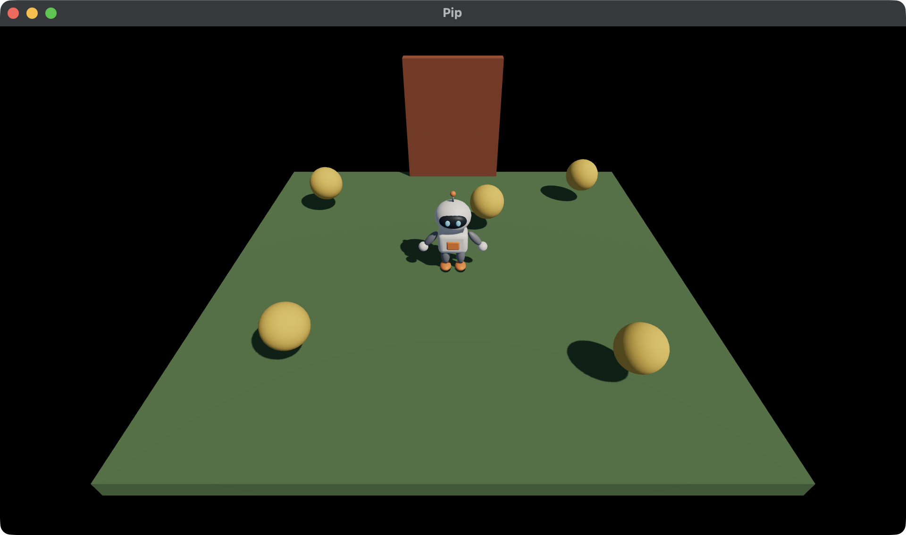

# 6. The door and the win

Pip collects pickups, but the game never ends. In this chapter, you add a
door at the far edge of the ground. It stays shut until Pip collects every
pickup. Then it rises, and Pip wins by walking into the doorway. You use:

- a phase in the Model, which tells `step` whether the game is still on,
- the `normal` and `depth` of a Contact, which push Pip out of the shut
  door,
- the `Quit` Command, which stops the game when you press Escape.



This chapter starts from your app from [5. Pickups](05-pickups.md). The
full app is
[`examples/tutorial/06-door/main.roc`](../../examples/tutorial/06-door/main.roc).
To see every change, compare the two chapter apps:

```sh
git diff --no-index examples/tutorial/05-pickups/main.roc examples/tutorial/06-door/main.roc
```

The imports and `pip.glb` stay the same, and so does the header:

```roc
app [init, launch, loaded, step, view] { cam: "{{camera_url}}", linalg: "{{linalg_url}}", mesh: "{{mesh_url}}", pf: platform "{{platform_url}}", roc: "{{roc_nightly}}" }
```

## The Model

The game has two phases: Pip is playing, or Pip has won. Add a `Phase`
type, and add the phase and the height of the door to the Model:

<!-- region: examples/tutorial/06-door/main.roc#model -->
```roc
# id is the draw id of the pickup and of its Collider.
Pickup : { id : U64, pos : Vec3 }

Phase : [Playing, Won]

# pip is 0, the fallback mesh, until loaded gives its id.
# yaw turns Pip about +y. At 0, Pip faces +z.
# door_lift goes from 0, shut, to door_height, open.
Model : { cube : U32, sphere : U32, pip : U32, pos : Vec3, yaw : F32, pickups : List(Pickup), door_lift : F32, phase : Phase }
```
<!-- endregion -->

A tag union such as `Phase` names each phase of the game. `step` matches
on it, so each phase gets its own rules, and Roc checks that `step`
handles every phase.

Give the door an id. It is higher than Pip's id, so Pip is still `a` in
each of its Contacts:

<!-- region: examples/tutorial/06-door/main.roc#ids -->
```roc
ground_id : U64
ground_id = 1

# Pip's id is lower than the id of every other Collider, so Pip is always `a`
# in a Contact.
pip_id : U64
pip_id = 2

door_id : U64
door_id = 3
```
<!-- endregion -->

The game starts in `Playing`, with the door shut:

<!-- region: examples/tutorial/06-door/main.roc#init -->
```roc
init : Vocabulary.Config -> { model : Model, commands : List(Command) }
init = |_config| {
	model = { cube: Mesh.primitive(Cube), sphere: Mesh.primitive(Sphere), pip: 0, pos: V.zero, yaw: 0.0, pickups: start_pickups, door_lift: 0.0, phase: Playing }
	{ model, commands: [Load({ pack: "pip", assets: ["pip"] })] }
}
```
<!-- endregion -->

## step

`step` now chooses its rules by the phase:

<!-- region: examples/tutorial/06-door/main.roc#step -->
```roc
step : Model, Vocabulary.Input, Vocabulary.QueryResults, F32 -> { model : Model, commands : List(Command) }
step = |model, input, results, dt| {
	contacts = results.contacts
	next = match model.phase {
		Playing => collect(model, contacts) |> push_out(contacts) |> walk(input, dt) |> raise_door(dt) |> win(contacts)
		Won => spin(model, dt)
	}
	{ model: next, commands: quit_on_escape(input) }
}

quit_on_escape : Vocabulary.Input -> List(Command)
quit_on_escape = |input| if Key.pressed(input, Escape) [Quit] else []
```
<!-- endregion -->

- While Pip plays, `step` runs the stages in order: collect the pickups,
  push Pip out of the door, walk, raise the door and check for the win.
  Each stage takes a Model and gives the next Model, so `|>` chains them.
- After the win, Pip ignores the keys and spins.
- In each phase, Escape gives the `Quit` Command. The host gives no key a
  meaning, so the game must quit by itself. `Key.pressed` is true only in
  the step after Escape went down, so Quit goes to the host once.

## The door

Here are the stages that the door needs:

<!-- region: examples/tutorial/06-door/main.roc#door -->
```roc
door_height : F32
door_height = 2.0

# Units each second.
door_speed : F32
door_speed = 1.5

raise_door : Model, F32 -> Model
raise_door = |model, dt|
	if List.is_empty(model.pickups) {
		{ ..model, door_lift: F32.min(model.door_lift + door_speed * dt, door_height) }
	} else {
		model
	}

is_open : Model -> Bool
is_open = |model| model.door_lift >= door_height

# Until the door is open, it pushes Pip back out of the doorway. The normal
# points from Pip to the door.
push_out : Model, List(Contact) -> Model
push_out = |model, contacts|
	match List.find_first(contacts, |c| c.a == pip_id and c.b == door_id) {
		Ok(c) if !is_open(model) => {
			back = V.sub(model.pos, V.scale(c.normal, c.depth))
			{ ..model, pos: { ..back, y: 0.0 } }
		}
		_ => model
	}

win : Model, List(Contact) -> Model
win = |model, contacts|
	if is_open(model) and List.contains(touched(contacts), door_id) {
		{ ..model, phase: Won }
	} else {
		model
	}

# Radians each second.
spin_speed : F32
spin_speed = 4.0

spin : Model, F32 -> Model
spin = |model, dt| { ..model, yaw: model.yaw + spin_speed * dt }
```
<!-- endregion -->

- `raise_door` lifts the door at `door_speed` once no pickups are left. It
  stops at `door_height`, and `is_open` is true from then on.
- `push_out` keeps Pip out of the shut door. A Contact's `normal` points
  from `a` to `b`, so from Pip to the door, and `depth` is how far the two
  shapes overlap. Moving Pip back along the normal by the depth takes Pip
  out of the door.
- `win` changes the phase to `Won` when Pip touches the open door.
- `spin` turns Pip about +y after the win.

The Contacts are one step old, so Pip walks a little way into the shut
door before `push_out` moves it back. At 120 steps each second, the
overlap is too small to see.

## view

`view` draws the door and gives it a Collider:

<!-- region: examples/tutorial/06-door/main.roc#view -->
```roc
# The door stands at the far edge of the ground.
door_half : Vec3
door_half = { x: 0.8, y: 0.5 * door_height, z: 0.1 }

door_pos : Vec3
door_pos = { x: 0.0, y: door_half.y, z: -2.9 }

view : Model -> Vocabulary.Scene
view = |model| {
	ground = { ..Draw.default, id: ground_id, mesh: model.cube, pos: { x: 0.0, y: -0.1, z: 0.0 }, scale: { x: 6.0, y: 0.2, z: 6.0 }, tint: { r: 0.12, g: 0.25, b: 0.1 } }
	pip = { ..Draw.default, id: pip_id, mesh: model.pip, pos: model.pos, rot: Quat.from_yaw(model.yaw) }
	door = { ..Draw.default, id: door_id, mesh: model.cube, pos: { ..door_pos, y: door_pos.y + model.door_lift }, scale: V.scale(door_half, 2.0), tint: { r: 0.45, g: 0.12, b: 0.05 } }
	pickups = model.pickups.map(|p| Draw(pickup(model.sphere, p)))
	camera = Cam.look_at({ x: 0.0, y: 3.6, z: 4.8 }, { x: 0.0, y: 0.0, z: 0.3 })
	# The box's centre is half its height up, so it stands on Pip's feet.
	pip_box = Collider.box(pip_id, { ..model.pos, y: pip_half.y }, Quat.from_yaw(model.yaw), pip_half)
	# The doorway keeps its Collider while the door rises.
	door_box = Collider.box(door_id, door_pos, Quat.identity, door_half)
	colliders = [Collider(pip_box), Collider(door_box)].concat(model.pickups.map(|p| Collider(Collider.sphere(p.id, p.pos, pickup_radius))))
	queries = [Query.contacts_of(pip_id)]
	nodes = [Light(sky_light), Light(sunlight), Draw(ground), Draw(pip), Draw(door)].concat(pickups).concat(colliders)
	{ ..Scene.empty, camera, nodes, queries }
}
```
<!-- endregion -->

The door's Draw rises by `door_lift`, but its Collider stays in the
doorway. So the same Collider stops Pip while the door is shut and wins
the game once it is open. The door is a cube, like the ground, so it uses
`model.cube`.

## Test the door and the win

Add these tests below the tests from chapter 5:

<!-- region: examples/tutorial/06-door/main.roc#tests -->
```roc
# With every pickup collected, the door rises to its full height.
expect {
	cleared = { ..start, pickups: [] }
	step(cleared, Input.empty, QueryResults.empty, 10.0).model.door_lift == door_height
}

# While one pickup is left, the door stays shut.
expect {
	one_left = { ..start, pickups: [{ id: 10, pos: V.zero }] }
	step(one_left, Input.empty, QueryResults.empty, 10.0).model.door_lift == 0.0
}

# A shut door pushes Pip back, and Pip has not won.
expect {
	at_door = { ..start, pos: { x: 0.0, y: 0.0, z: -2.6 } }
	after = step(at_door, Input.empty, contact_with(door_id), 0.1).model
	near(after.pos.z, -2.5) and after.phase == Playing
}

# Pip wins when it walks into the open door.
expect {
	open = { ..start, pickups: [], door_lift: door_height }
	step(open, Input.empty, contact_with(door_id), 0.1).model.phase == Won
}

# After the win, the keys no longer move Pip.
expect {
	won = { ..start, phase: Won }
	step(won, hold([W]), QueryResults.empty, 0.1).model.pos == start.pos
}

# Escape quits at any time.
expect {
	escape = { ..Input.empty, pressed: [Key.code(Escape)] }
	step(start, escape, QueryResults.empty, 0.1).commands == [Quit]
}
```
<!-- endregion -->

The `contact_with` helper from chapter 5 gives a Contact with a normal of
-z, as if Pip walks into the door from the front. A test can set any
field of the Model, so the win test starts with the door already open. Run
the tests:

```sh
roc test main.roc
```

## Run the game

In `pip/`, run:

```sh
roc main.roc
```

Collect every pickup. The door rises. Walk Pip into the doorway, and Pip
spins. Press Escape to quit.

You can't yet see how many pickups are left, or that you have won. Next,
read [7. A HUD](07-hud.md). It puts the count and a message on the screen.
