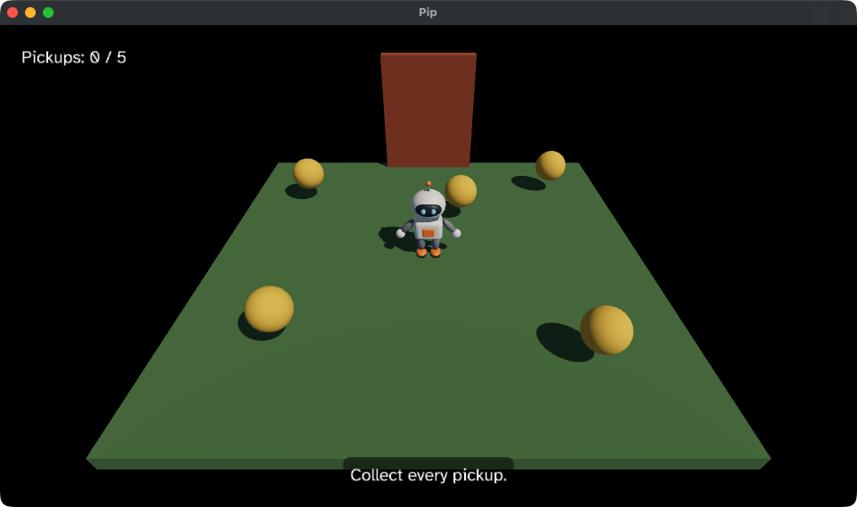

# 7. A HUD

The game works, but it tells the player nothing. You can't see how many
pickups are left, that the door is open, or that you have won. In this
chapter, you add a HUD: text that sits over the game. You use:

- the `ui` field of the Scene, which the host draws over the 3D view,
- the `Box` and `Text` Elements, which build the UI as a tree,
- the `ui` package, which gives the starting values for a Box and a Text.



This chapter starts from your app from
[6. The door and the win](06-door.md). The full app is
[`examples/tutorial/07-hud/main.roc`](../../examples/tutorial/07-hud/main.roc).
To see every change, compare the two chapter apps:

```sh
git diff --no-index examples/tutorial/06-door/main.roc examples/tutorial/07-hud/main.roc
```

`pip.glb` stays the same.

## The header and the imports

Add the `ui` package to the header:

```roc
app [init, launch, loaded, step, view] { cam: "{{camera_url}}", linalg: "{{linalg_url}}", mesh: "{{mesh_url}}", pf: platform "{{platform_url}}", roc: "{{roc_nightly}}", ui: "{{ui_url}}" }
```

Then import `ui.Ui`, and add `Element` to the exposed types:

<!-- region: examples/tutorial/07-hud/main.roc#imports -->
```roc
import cam.Camera as Cam
import linalg.Vec3 as V
import linalg.Quat
import mesh.Mesh as Mesh
import ui.Ui
import pf.Vocabulary exposing [Command, Contact, Element, Manifest, Vec3]
import pf.Collider
import pf.Config
import pf.Draw
import pf.Input
import pf.Key
import pf.Launch
import pf.Light
import pf.Query
import pf.QueryResults
import pf.Scene
```
<!-- endregion -->

## The HUD

Your game can't lay out the UI itself, because it cannot measure a string.
So the host does the layout. Your game describes the UI as a tree of Boxes
and Text, and the host places them.

<!-- region: examples/tutorial/07-hud/main.roc#hud -->
```roc
# A line of HUD text never wraps.
label : Str -> Ui.Text
label = |str| { ..Ui.label(str), wrap: None }

count_text : Model -> Str
count_text = |model| {
	total = List.len(start_pickups)
	collected = total - List.len(model.pickups)
	"Pickups: ${collected.to_str()} / ${total.to_str()}"
}

status_text : Model -> Str
status_text = |model| match model.phase {
	Playing if is_open(model) => "The door is open. Walk through it."
	Playing if List.is_empty(model.pickups) => "The door is opening."
	Playing => "Collect every pickup."
	Won => "You win! Press Escape to quit."
}

# A bottom point of the window needs a negative y offset to move up into it.
hud : Model -> List(Element)
hud = |model| {
	count = Box(Ui.panel(LeftTop, { x: 16.0, y: 16.0 }), [Text(label(count_text(model)))])
	status = Box(Ui.panel(CenterBottom, { x: 0.0, y: -16.0 }), [Text(label(status_text(model)))])
	[count, status]
}
```
<!-- endregion -->

- `count_text` and `status_text` give the strings. They read only the
  Model, so the tests can check them without the host. `status_text`
  uses `is_open` from chapter 6, so it says that the door is open only
  once the door has risen all the way.
- `Text(...)` is an Element that draws one string. `label` starts from
  `Ui.label`, which gives white text 24 pixels high, and turns wrapping
  off, so a line of the HUD never breaks.
- `Box(config, children)` is an Element that holds other Elements.
  `Ui.panel` gives the config of a Box that floats over the window at one
  of its points, with padding, a see-through black background and round
  corners. Each Box here holds one Text.
- The count sits at the top left. The status sits at the bottom centre, so
  it moves up by 16 pixels with a negative `y`.

`hud` returns the two Boxes as a list. They are the roots of the UI tree.
[The UI](../ui.md) explains Boxes, Text and the layout rules.

## view

Put the HUD in the Scene:

<!-- region: examples/tutorial/07-hud/main.roc#view -->
```roc
view : Model -> Vocabulary.Scene
view = |model| {
	ground = { ..Draw.default, id: ground_id, mesh: model.cube, pos: { x: 0.0, y: -0.1, z: 0.0 }, scale: { x: 6.0, y: 0.2, z: 6.0 }, tint: { r: 0.12, g: 0.25, b: 0.1 } }
	pip = { ..Draw.default, id: pip_id, mesh: model.pip, pos: model.pos, rot: Quat.from_yaw(model.yaw) }
	door = { ..Draw.default, id: door_id, mesh: model.cube, pos: { ..door_pos, y: door_pos.y + model.door_lift }, scale: V.scale(door_half, 2.0), tint: { r: 0.45, g: 0.12, b: 0.05 } }
	pickups = model.pickups.map(|p| Draw(pickup(model.sphere, p)))
	camera = Cam.look_at({ x: 0.0, y: 3.6, z: 4.8 }, { x: 0.0, y: 0.0, z: 0.3 })
	# The box's centre is half its height up, so it stands on Pip's feet.
	pip_box = Collider.box(pip_id, { ..model.pos, y: pip_half.y }, Quat.from_yaw(model.yaw), pip_half)
	# The doorway keeps its Collider while the door rises.
	door_box = Collider.box(door_id, door_pos, Quat.identity, door_half)
	colliders = [Collider(pip_box), Collider(door_box)].concat(model.pickups.map(|p| Collider(Collider.sphere(p.id, p.pos, pickup_radius))))
	queries = [Query.contacts_of(pip_id)]
	nodes = [Light(sky_light), Light(sunlight), Draw(ground), Draw(pip), Draw(door)].concat(pickups).concat(colliders)
	{ ..Scene.empty, camera, nodes, queries, ui: hud(model) }
}
```
<!-- endregion -->

Like the rest of the Scene, `view` builds the HUD again at each step, from
the Model. The text changes as soon as the Model does, with no code to
update it.

## Test the HUD

Add these tests below the tests from chapter 6:

<!-- region: examples/tutorial/07-hud/main.roc#tests -->
```roc
expect count_text(start) == "Pickups: 0 / 5"

# Each pickup that Pip collects counts up by one.
expect {
	after = step(start, Input.empty, contact_with(12), 0.1).model
	count_text(after) == "Pickups: 1 / 5"
}

expect status_text({ ..start, pickups: [] }) == "The door is opening."

expect status_text({ ..start, pickups: [], door_lift: door_height }) == "The door is open. Walk through it."

expect status_text({ ..start, phase: Won }) == "You win! Press Escape to quit."
```
<!-- endregion -->

Run the tests:

```sh
roc test main.roc
```

## Play the game

In `pip/`, run:

```sh
roc main.roc
```

Collect the five pickups and watch the count go up. When the door opens,
walk Pip through it. The HUD says that you have won. Press Escape to quit.

The game plays from start to end, but it is silent. Next, read
[8. Sound](08-sound.md). It plays a blip on each pickup, and adds music, a
hum at the door and a creak as the door opens.
