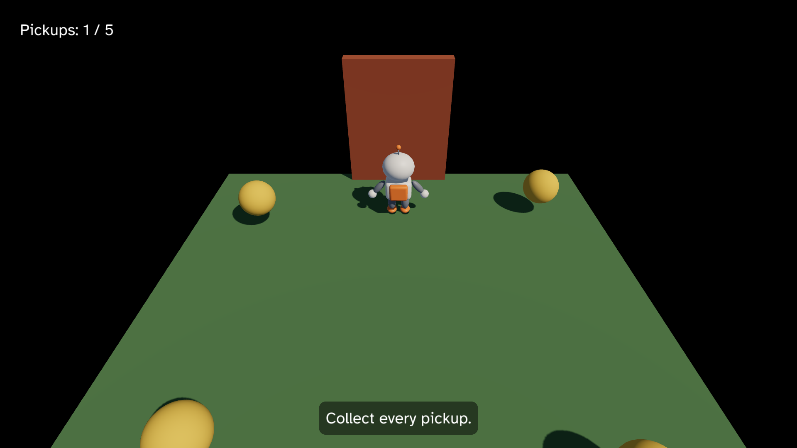

# 8. Sound

The game works, and the HUD tells the player what is going on, but the game
is silent. In this chapter, you add three sounds:

- a blip when Pip takes a pickup, with the `Play` Command,
- music that plays all the time, with a Loop in the Scene,
- a hum at the door that gets louder as Pip comes closer, with a Loop that
  has a place.



This chapter starts from your app from [7. A HUD](07-hud.md). The full app
is
[`examples/tutorial/08-sound/main.roc`](../../examples/tutorial/08-sound/main.roc).
To see every change, compare the two chapter apps:

```sh
git diff --no-index examples/tutorial/07-hud/main.roc examples/tutorial/08-sound/main.roc
```

The header and `pip.glb` stay the same.

## Get the sound files

A Sound is an asset, like Pip's mesh. The host reads `.wav` and `.ogg`
files from `assets/sound/`.

1. Make the folder `pip/assets/sound/`.
2. Download
   [`blip.wav`](../../examples/tutorial/08-sound/assets/sound/blip.wav?raw=true),
   [`hum.wav`](../../examples/tutorial/08-sound/assets/sound/hum.wav?raw=true)
   and
   [`music.wav`](../../examples/tutorial/08-sound/assets/sound/music.wav?raw=true).
3. Put them in `pip/assets/sound/`.

A Sound takes the name `sound/` and its file stem, so `blip.wav` is
`sound/blip`.

The three files come from a Python script,
[`examples/tutorial/source/make_sounds.py`](../../examples/tutorial/source/make_sounds.py).
It builds each sound from sine waves, so you can change a note and run it
again.

## The imports

Import `pf.Loop` and `pf.Sound`:

<!-- region: examples/tutorial/08-sound/main.roc#imports -->
```roc
import cam.Camera as Cam
import linalg.Vec3 as V
import linalg.Quat
import mesh.Mesh as Mesh
import ui.Ui
import pf.Vocabulary exposing [Command, Contact, Element, Manifest, Vec3]
import pf.Collider
import pf.Config
import pf.Draw
import pf.Input
import pf.Key
import pf.Launch
import pf.Light
import pf.Loop
import pf.Query
import pf.QueryResults
import pf.Scene
import pf.Sound
```
<!-- endregion -->

## The Model

A Sound id works like a mesh id. The host gives it to you in the Manifest,
and you keep it in your Model. Add the three Sound ids:

<!-- region: examples/tutorial/08-sound/main.roc#model -->
```roc
# A Sound id of 0 plays nothing.
Sounds : { blip : U32, hum : U32, music : U32 }

# pip is 0, the fallback mesh, and each Sound id is 0 until loaded gives the ids.
# yaw turns Pip about +y. At 0, Pip faces +z.
# door_lift goes from 0, shut, to door_height, open.
Model : { cube : U32, sphere : U32, pip : U32, sounds : Sounds, pos : Vec3, yaw : F32, pickups : List(Pickup), door_lift : F32, phase : Phase }
```
<!-- endregion -->

## Load the Sounds

Add the three Sound names to the `Load` of the `pip` Pack, and keep their
ids in `loaded`:

<!-- region: examples/tutorial/08-sound/main.roc#load -->
```roc
init : Vocabulary.Config -> { model : Model, commands : List(Command) }
init = |_config| {
	model = { cube: Mesh.primitive(Cube), sphere: Mesh.primitive(Sphere), pip: 0, sounds: { blip: 0, hum: 0, music: 0 }, pos: V.zero, yaw: 0.0, pickups: start_pickups, door_lift: 0.0, phase: Playing }
	{ model, commands: [Load({ pack: "pip", assets: ["pip", "sound/blip", "sound/hum", "sound/music"] })] }
}

loaded : Model, Str, Manifest -> Model
loaded = |model, _pack, manifest| {
	sounds = { blip: Sound.resolve(manifest, "sound/blip"), hum: Sound.resolve(manifest, "sound/hum"), music: Sound.resolve(manifest, "sound/music") }
	{ ..model, pip: Mesh.resolve(manifest, "pip"), sounds }
}
```
<!-- endregion -->

The Sounds load with Pip, so one Manifest holds all four ids.
`Sound.resolve` finds a Sound id in it, as `Mesh.resolve` finds Pip's mesh
id. If a name is not on disk, it gets id 0 and the host logs it once. A
Sound id of 0 plays nothing, so a missing file leaves the game silent but
running.

## Play the blip

A sound that plays once is a Command, like `Load` or `Quit`. Return it from
`step`, and the host starts the sound in the same fixed step:

<!-- region: examples/tutorial/08-sound/main.roc#step -->
```roc
step : Model, Vocabulary.Input, Vocabulary.QueryResults, F32 -> { model : Model, commands : List(Command) }
step = |model, input, results, dt| {
	contacts = results.contacts
	next = match model.phase {
		Playing => collect(model, contacts) |> push_out(contacts) |> walk(input, dt) |> raise_door(dt) |> win(contacts)
		Won => spin(model, dt)
	}
	{ model: next, commands: quit_on_escape(input).concat(blip(model, next)) }
}

# A blip plays once when Pip collects a pickup. Two pickups in one step make one blip.
blip : Model, Model -> List(Command)
blip = |before, after|
	if List.len(after.pickups) < List.len(before.pickups) {
		[Sound.play(after.sounds.blip)]
	} else {
		[]
	}
```
<!-- endregion -->

- `blip` compares the pickups before and after the step. If Pip collected
  one, it returns a Play of the blip.
- `Sound.play(id)` gives a `Play` at gain 1 and pitch 1, `Here`: the blip
  sounds the same in both ears, wherever Pip is. To play it louder, softer
  or at another pitch, write the `Play` record yourself, as
  [Sound](../sound.md#play-a-sound-once) shows.

Once a Play starts, it plays to its end. Your game can't stop it, and it
doesn't need to remember it.

## The music and the hum

A sound that repeats is a Loop. A Loop is not a Command: it goes in the
`loops` field of the Scene, like a Draw goes in `nodes`. The Sound plays for
as long as its Loop stays in the Scene. Add the Loops:

<!-- region: examples/tutorial/08-sound/main.roc#loops -->
```roc
# The door's centre, as it rises.
door_at : Model -> Vec3
door_at = |model| { ..door_pos, y: door_pos.y + model.door_lift }

music_loop_id : U64
music_loop_id = 1

hum_loop_id : U64
hum_loop_id = 2

# Past this distance from the camera, the hum is silent.
hum_range : F32
hum_range = 10.0

# The hum fades as the door rises, and stops when the door is open.
loops : Model -> List(Vocabulary.Loop)
loops = |model| {
	music = { ..Loop.default, id: music_loop_id, sound: model.sounds.music, gain: 0.5 }
	hum = { ..Loop.default, id: hum_loop_id, sound: model.sounds.hum, gain: 1.0 - model.door_lift / door_height, at: At({ pos: door_at(model), range: hum_range }) }
	if is_open(model) [music] else [music, hum]
}
```
<!-- endregion -->

The host pairs each Loop with the Loop that had the same `id` in the
previous Scene, as it pairs Draws:

- A new id starts the Sound from its start.
- An id that stays keeps the Sound playing. If its gain, pitch or place
  changed, the change applies on the next fixed step.
- An id that leaves the Scene stops the Sound.

Loop ids are separate from Draw ids, so the music can be 1 while the ground
is Draw 1. Keep each Loop's id the same from step to step.

The music plays `Here`, at half its recorded gain. The hum plays `At` the
door, with a `range` of 10. `door_at` gives the centre of the door as it
rises. It is loudest at the door, gets quieter with
distance, and is silent 10 units away. It also comes from the side it is
on: if the door is on your left, you hear the hum in your left ear.

When the door opens, the hum stops. Why not take it out of the list at
once? A Loop that leaves the Scene stops in 5 milliseconds. That is fast
enough to sound like a cut, but it keeps the speaker from clicking. To fade
a sound out, lower its gain over many steps instead. So the hum's gain goes
from 1 down to 0 as the door rises, and the Loop leaves the list only when
the door is open and the hum is already silent.

## The Listener follows Pip

Who hears the hum? In rocco, the Listener is the camera of the Scene. A
Loop `At` the door is loud when the camera is close to the door.

In chapter 7, the camera stands still, so the hum would sound the same
wherever Pip went. In `view`, make the camera follow Pip with `Cam.follow`:

<!-- region: examples/tutorial/08-sound/main.roc#view -->
```roc
camera_offset : Vec3
camera_offset = { x: 0.0, y: 3.6, z: 4.5 }

view : Model -> Vocabulary.Scene
view = |model| {
	ground = { ..Draw.default, id: ground_id, mesh: model.cube, pos: { x: 0.0, y: -0.1, z: 0.0 }, scale: { x: 6.0, y: 0.2, z: 6.0 }, tint: { r: 0.12, g: 0.25, b: 0.1 } }
	pip = { ..Draw.default, id: pip_id, mesh: model.pip, pos: model.pos, rot: Quat.from_yaw(model.yaw) }
	door = { ..Draw.default, id: door_id, mesh: model.cube, pos: door_at(model), scale: V.scale(door_half, 2.0), tint: { r: 0.45, g: 0.12, b: 0.05 } }
	pickups = model.pickups.map(|p| Draw(pickup(model.sphere, p)))
	# The camera is the Listener, so it follows Pip to let you hear the door come closer.
	camera = Cam.follow({ ..model.pos, z: model.pos.z + 0.3 }, camera_offset)
	# The box's centre is half its height up, so it stands on Pip's feet.
	pip_box = Collider.box(pip_id, { ..model.pos, y: pip_half.y }, Quat.from_yaw(model.yaw), pip_half)
	# The doorway keeps its Collider while the door rises.
	door_box = Collider.box(door_id, door_pos, Quat.identity, door_half)
	colliders = [Collider(pip_box), Collider(door_box)].concat(model.pickups.map(|p| Collider(Collider.sphere(p.id, p.pos, pickup_radius))))
	queries = [Query.contacts_of(pip_id)]
	nodes = lights.concat([Draw(ground), Draw(pip), Draw(door)]).concat(pickups).concat(colliders)
	{ ..Scene.empty, camera, nodes, queries, ui: hud(model), loops: loops(model) }
}
```
<!-- endregion -->

At the start, the camera is where it was in chapter 7. As Pip walks, the
camera keeps the same offset behind Pip, and so does the Listener. Walk
toward the door, and the hum gets louder. Walk to the left, and the hum
moves to your right ear.

`view` also puts the Loops in the Scene, with `loops: loops(model)`. The
door's Draw now uses `door_at` too, so the door and its hum rise together.

## Test the sounds

A Play is a value, like `Quit`, and the Loops are part of the Scene. So you
test them without the host. Add these tests below the tests from chapter 7:

<!-- region: examples/tutorial/08-sound/main.roc#tests -->
```roc
with_sounds : Model
with_sounds = { ..start, sounds: { blip: 7, hum: 8, music: 9 } }

# Pip collects a pickup, and the step plays the blip once.
expect step(with_sounds, Input.empty, contact_with(12), 0.1).commands == [Sound.play(7)]

# With no pickup collected, nothing plays.
expect step(with_sounds, Input.empty, QueryResults.empty, 0.1).commands == []

# The music plays Here, and the hum plays at the door while it is shut.
expect {
	scene = view(with_sounds)
	ids = scene.loops.map(|l| l.id)
	sounds = scene.loops.map(|l| l.sound)
	places = scene.loops.map(|l| l.at)
	ids == [music_loop_id, hum_loop_id] and sounds == [9, 8] and places == [Here, At({ pos: door_pos, range: hum_range })]
}

# Halfway up, the hum plays at half gain.
expect {
	half = view({ ..with_sounds, pickups: [], door_lift: 0.5 * door_height })
	half.loops.map(|l| l.gain) == [0.5, 0.5]
}

# Once the door is open, only the music plays.
expect view({ ..with_sounds, pickups: [], door_lift: door_height }).loops.map(|l| l.id) == [music_loop_id]
```
<!-- endregion -->

Run the tests:

```sh
roc test main.roc
```

## Play the game

In `pip/`, run:

```sh
roc main.roc
```

The music starts at once, and the hum is quiet. Walk toward the door and
listen to the hum grow. Each pickup blips. When you take the last one, the
hum fades away while the door rises. Press Escape to quit.

If you hear nothing, read the log. If the host can't open the audio device,
it says so once, and the game runs with no sound. If a name in the `Load`
is wrong, the log names it.

You have made a whole game: a character that you load from a file, moves
with the keys, collects pickups and wins, with lights, a shadow, a HUD and
sound.

The tutorial goes on when rocco gets a gamepad and animation. Until then,
the guide pages explain each part in more detail. Start with
[Sound](../sound.md), [Collisions and Queries](../collisions.md) and
[The UI](../ui.md), or read [Shipping a game](../shipping.md) to build your
game for other people.
