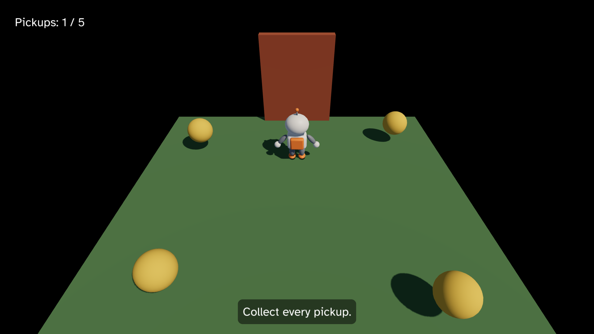

# 9. A gamepad

Pip walks with W, A, S and D, but many players would rather hold a gamepad.
A key is either down or up, so Pip walks at full speed or not at all. A
stick tells you how far the player pushes it, so Pip can creep or run. In
this chapter, you:

- walk Pip with the left stick, as well as the keys,
- make the speed follow how far the stick is pushed,
- quit with Start, as Escape does.



This chapter starts from your app from [8. Sound](08-sound.md). The full
app is
[`examples/tutorial/09-gamepad/main.roc`](../../examples/tutorial/09-gamepad/main.roc).
To see every change, compare the two chapter apps:

```sh
git diff --no-index examples/tutorial/08-sound/main.roc examples/tutorial/09-gamepad/main.roc
```

The header, the assets and the Model stay the same. You need no new asset:
the host reads the pads for you. Plug in an Xbox, PlayStation or Switch Pro
pad, or connect one over Bluetooth. [Gamepads](../gamepad.md) lists which
pads each OS reads.

## The imports

Import `pf.GamepadButton`:

<!-- region: examples/tutorial/09-gamepad/main.roc#imports -->
```roc
import cam.Camera as Cam
import linalg.Vec3 as V
import linalg.Quat
import mesh.Mesh as Mesh
import ui.Ui
import pf.Vocabulary exposing [Command, Contact, Element, Manifest, Vec3]
import pf.Collider
import pf.Config
import pf.Draw
import pf.GamepadButton
import pf.Input
import pf.Key
import pf.Launch
import pf.Light
import pf.Query
import pf.QueryResults
import pf.Scene
import pf.Sound
import pf.Speaker
```
<!-- endregion -->

`GamepadButton` names the buttons of a pad, as `Key` names the keys.

## Walk with the stick

The Input has a list, `gamepads`, with one Gamepad for each pad that is
connected. Each Gamepad has a `left_stick` with an `x` and a `y`, each from
-1 to 1. Pushed all the way right, the stick reads `x: 1.0`. Pushed all the
way up, it reads `y: 1.0`. At rest it reads 0, because the host ignores the
small wobble of a stick near its centre.

In chapter 3, `walk` turned the keys into a direction and normalized it, so
Pip always walked at `speed`. Now the stick adds to the keys:

<!-- region: examples/tutorial/09-gamepad/main.roc#walk -->
```roc
# Units each second.
speed : F32
speed = 2.5

# Pip stops this far from the centre, inside the edge of the ground.
edge : F32
edge = 2.7

# The left sticks of all the pads, added up.
left_stick : Vocabulary.Input -> { x : F32, y : F32 }
left_stick = |input| List.fold(input.gamepads, { x: 0.0, y: 0.0 }, |sum, pad| { x: sum.x + pad.left_stick.x, y: sum.y + pad.left_stick.y })

# A vector longer than 1 shrinks to length 1. A shorter one stays as it is.
clamp_to_disc : Vec3 -> Vec3
clamp_to_disc = |v|
	if V.length(v) > 1.0 {
		V.normalize(v)
	} else {
		v
	}

# W and the stick pushed up move away from the camera, toward -z.
walk : Model, Vocabulary.Input, F32 -> Model
walk = |model, input, dt| {
	stick = left_stick(input)
	dir = clamp_to_disc({ x: Key.axis(input, A, D) + stick.x, y: 0.0, z: Key.axis(input, W, S) - stick.y })
	if dir == V.zero {
		model
	} else {
		moved = V.add(model.pos, V.scale(dir, speed * dt))
		{ ..model, pos: { x: keep_on_ground(moved.x), y: 0.0, z: keep_on_ground(moved.z) }, yaw: F32.atan2({ x: dir.z, y: dir.x }) }
	}
}
```
<!-- endregion -->

- `left_stick` adds up the left sticks of all the pads. With no pad, the
  list is empty and the sum is 0, so the keys work as before.
- The stick's `y` is up, but walking away from the camera is toward -z, so
  `walk` subtracts `stick.y` from the z axis.
- `walk` no longer normalizes `dir`. A stick pushed halfway gives a `dir`
  of length 0.5, and Pip walks at half speed.
- `clamp_to_disc` keeps `dir` from growing past length 1. Without it, W and
  D together would give a length of about 1.4, and so would W with the
  stick pushed up. Pip would walk faster on a diagonal, or with two inputs
  at once.

Keys still give a length of 0 or 1, so with the keys alone Pip walks as it
did in chapter 8.

## Quit with Start

Escape quits from the keyboard. Make Start quit from a pad:

<!-- region: examples/tutorial/09-gamepad/main.roc#quit -->
```roc
# Escape on the keyboard or Start on any pad quits.
quit : Vocabulary.Input -> List(Command)
quit = |input| if Key.pressed(input, Escape) or GamepadButton.pressed_any(input, Start) [Quit] else []
```
<!-- endregion -->

In `step`, call `quit(input)` in place of `quit_on_escape(input)`. The win
message in `status_text` now says "Press Escape or Start to quit."

A pad button is held or pressed, as a key is. `GamepadButton.pressed_any`
is true in the first step after Start went down, so one press quits once.

## Slots and pressed_any

Each Gamepad has a `slot`, from 0 to 3. The first pad that connects takes
slot 0, the next one slot 1, and so on. A pad keeps its slot while it stays
connected, and a new pad takes the lowest free slot. The slot tells two
players apart: in a game for two, the pad in slot 0 is player one and the
pad in slot 1 is player two.

The functions of `GamepadButton` come in two kinds:

- `GamepadButton.held(gamepad, b)` and `GamepadButton.pressed(gamepad, b)`
  ask one pad. Use them when it matters who pressed the button, such as in
  a game for two players.
- `GamepadButton.held_any(input, b)` and
  `GamepadButton.pressed_any(input, b)` ask every pad. Use them in a game
  for one player.

Pip's game has one player, so it asks any pad, and `walk` adds up the
sticks of all the pads. The player can pick up any pad, and the game does
not need to know its slot.

## Test the gamepad

A Gamepad is a record, so you test the stick and the buttons without a pad.
Add these tests below the tests from chapter 8:

<!-- region: examples/tutorial/09-gamepad/main.roc#tests -->
```roc
with_pads : List(Vocabulary.Gamepad) -> Vocabulary.Input
with_pads = |pads| { ..Input.empty, gamepads: pads }

# The stick halfway up walks Pip toward -z at half speed.
expect {
	half_up = { ..Input.idle_gamepad, left_stick: { x: 0.0, y: 0.5 } }
	moved = step(start, with_pads([half_up]), QueryResults.empty, 0.1).model
	near(moved.pos.z, -0.125) and near(moved.pos.x, 0.0) and near(moved.yaw, pi)
}

# The stick all the way right walks Pip toward +x at full speed.
expect {
	right = { ..Input.idle_gamepad, left_stick: { x: 1.0, y: 0.0 } }
	moved = step(start, with_pads([right]), QueryResults.empty, 0.1).model
	near(moved.pos.x, 0.25) and near(moved.pos.z, 0.0)
}

# W and the stick up together walk Pip no faster than W alone.
expect {
	up = { ..Input.idle_gamepad, left_stick: { x: 0.0, y: 1.0 } }
	both = { ..with_pads([up]), held: [Key.code(W)] }
	moved = step(start, both, QueryResults.empty, 0.1).model
	near(V.length(moved.pos), 0.25)
}

# A pad at rest leaves Pip where it is.
expect step(start, with_pads([Input.idle_gamepad]), QueryResults.empty, 0.1).model == start

# Start pressed on any pad quits, here on the pad in slot 2.
expect {
	start_pressed = { ..Input.idle_gamepad, slot: 2, pressed: [GamepadButton.code(Start)] }
	step(start, with_pads([Input.idle_gamepad, start_pressed]), QueryResults.empty, 0.1).commands == [Quit]
}

# Start held from an earlier step does not quit again.
expect {
	start_held = { ..Input.idle_gamepad, held: [GamepadButton.code(Start)] }
	step(start, with_pads([start_held]), QueryResults.empty, 0.1).commands == []
}
```
<!-- endregion -->

`Input.idle_gamepad` is a pad in slot 0 with no button down and the sticks
at rest. Each test copies it and changes only the fields it needs. A
Gamepad holds button codes, as the Input holds key codes, so the tests
make them with `GamepadButton.code`. Also change the test of the win
message to "You win! Press Escape or Start to quit."

Run the tests:

```sh
roc test main.roc
```

## Play the game

In `pip/`, run:

```sh
roc main.roc
```

Push the left stick a little, and Pip creeps. Push it all the way, and Pip
walks as fast as with the keys. Collect the pickups and walk through the
door, then press Start to quit.

If Pip doesn't move, check that the game window is in front: on macOS, the
pad sends nothing to a window in the back. Then read the limits for your OS
in [Gamepads](../gamepad.md#limits). On Windows, a pad that
you plug in can take a second to appear.

Next, read [10. Animation](10-animation.md). It plays the Idle and Walk
Clips on Pip, so it walks instead of gliding. For the triggers, the slots
and the Bridge, read [Gamepads](../gamepad.md).
