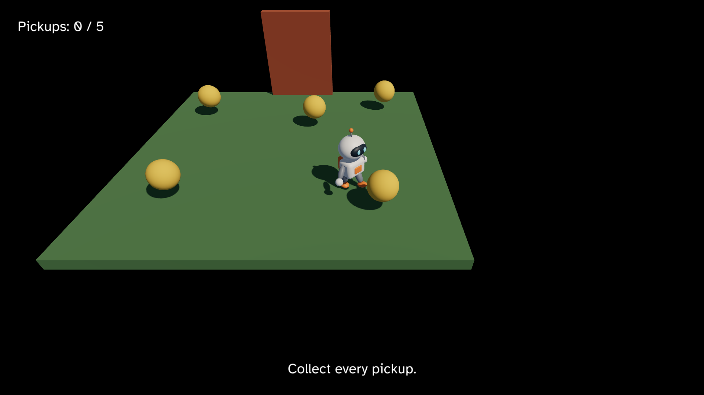

# 10. Animation

Pip walks, collects pickups and wins, but it glides over the ground like a
statue. Pip's mesh file already holds what it needs to move its arms and
legs: a Skin with 12 Joints and two Clips, Idle and Walk. Until now, no
Draw named a Clip, so Pip stood still in its bind pose. In this chapter,
you:

- find the Idle and Walk Clips in the Manifest,
- keep the time of each Clip in your Model,
- fade from Idle to Walk while Pip moves, and back when it stops.



This chapter starts from your app from [9. A gamepad](09-gamepad.md). The
full app is
[`examples/tutorial/10-animation/main.roc`](../../examples/tutorial/10-animation/main.roc).
To see every change, compare the two chapter apps:

```sh
git diff --no-index examples/tutorial/09-gamepad/main.roc examples/tutorial/10-animation/main.roc
```

The header and the sounds stay the same. If you downloaded `pip.glb` before
rocco could load a Skin, your copy may have no Clips. Download
[`pip.glb`](../../examples/tutorial/10-animation/assets/meshes/pip.glb?raw=true)
again into `pip/assets/meshes/`.

## The imports

Import `pf.Pose`:

<!-- region: examples/tutorial/10-animation/main.roc#imports -->
```roc
import cam.Camera as Cam
import linalg.Vec3 as V
import linalg.Quat
import mesh.Mesh as Mesh
import ui.Ui
import pf.Vocabulary exposing [Command, Contact, Element, Manifest, Vec3]
import pf.Button
import pf.Collider
import pf.Config
import pf.Draw
import pf.Input
import pf.Key
import pf.Launch
import pf.Light
import pf.Loop
import pf.Pose
import pf.Query
import pf.QueryResults
import pf.Scene
import pf.Sound
```
<!-- endregion -->

`Pose` builds the `pose` of a Draw and wraps the time of a Clip that
repeats. The `linalg` package also has a module called `Pose`, for a
position and a rotation. Pip's app does not import it. If your game needs
both, import one of them under another name with `as`, as this app does
with `cam.Camera as Cam`.

## Clips in the Manifest

A Clip is one named set of keys for the Joints of a Skin, such as Idle or
Walk. When a Pack loads, the host gives each Clip an id, and the Manifest
entry of its mesh lists the Clips with their names, ids and durations. As
with mesh ids, the game keeps the ids it needs in its Model:

<!-- region: examples/tutorial/10-animation/main.roc#model -->
```roc
# A Clip id of 0 is no Clip, so Pip stands in its bind pose. Each duration is
# 0 until loaded gives it.
Clips : { idle : U32, walk : U32, idle_duration : F32, walk_duration : F32 }

# Each time is in seconds, wrapped into its Clip. fade goes from 0, all Idle,
# to 1, all Walk.
Animation : { idle_time : F32, walk_time : F32, fade : F32 }

# pip is 0, the fallback mesh, and each Sound id is 0 until loaded gives the ids.
# yaw turns Pip about +y. At 0, Pip faces +z.
# door_lift goes from 0, shut, to door_height, open.
Model : { cube : U32, sphere : U32, pip : U32, sounds : Sounds, clips : Clips, animation : Animation, pos : Vec3, yaw : F32, pickups : List(Pickup), door_lift : F32, phase : Phase }
```
<!-- endregion -->

- `Clips` holds the id and the duration in seconds of each Clip.
- `Animation` holds what the Model moves each step: the time of each Clip
  and the fade between them.

Clip id 0 is no Clip, and a mesh with no Clip draws in its bind pose. So
`init` starts with zeros, as it does for the mesh and Sound ids:

<!-- region: examples/tutorial/10-animation/main.roc#init -->
```roc
init : Vocabulary.Config -> { model : Model, commands : List(Command) }
init = |_config| {
	clips = { idle: 0, walk: 0, idle_duration: 0.0, walk_duration: 0.0 }
	animation = { idle_time: 0.0, walk_time: 0.0, fade: 0.0 }
	model = { cube: Mesh.primitive(Cube), sphere: Mesh.primitive(Sphere), pip: 0, sounds: { blip: 0, hum: 0, music: 0 }, clips, animation, pos: V.zero, yaw: 0.0, pickups: start_pickups, door_lift: 0.0, phase: Playing }
	{ model, commands: [Load({ pack: "pip", assets: ["pip", "sound/blip", "sound/hum", "sound/music"] })] }
}
```
<!-- endregion -->

In `loaded`, find the two Clips by the mesh's name and the Clip's name:

<!-- region: examples/tutorial/10-animation/main.roc#loaded -->
```roc
loaded : Model, Str, Manifest -> Model
loaded = |model, _pack, manifest| {
	sounds = { blip: Sound.resolve(manifest, "sound/blip"), hum: Sound.resolve(manifest, "sound/hum"), music: Sound.resolve(manifest, "sound/music") }
	idle = Mesh.clip(manifest, "pip", "Idle")
	walk = Mesh.clip(manifest, "pip", "Walk")
	clips = { idle, walk, idle_duration: Mesh.clip_duration(manifest, idle), walk_duration: Mesh.clip_duration(manifest, walk) }
	{ ..model, pip: Mesh.resolve(manifest, "pip"), sounds, clips }
}
```
<!-- endregion -->

`Mesh.clip(manifest, "pip", "Idle")` gives the id of the Idle Clip of the
mesh `pip`. If the mesh or the Clip is not in the Manifest, it gives 0 and
prints the two names with `dbg`, so a misspelt name shows up in the log.
`Mesh.clip_duration` gives the duration of a Clip id, or 0 for an id it
does not know.

## The time is yours

The host has no clock for a Clip. Each step, the Model moves the time of
each Clip, and `view` tells the host which Clip to draw at which time. That
keeps `step` pure: a test can put Pip at any moment of any Clip.

In `step`, pipe the next Model through `animate`. It runs after the
`match`, so it sees how far Pip moved in this step, in either phase:

<!-- region: examples/tutorial/10-animation/main.roc#step -->
```roc
step : Model, Vocabulary.Input, Vocabulary.QueryResults, F32 -> { model : Model, commands : List(Command) }
step = |model, input, results, dt| {
	contacts = results.contacts
	next = match model.phase {
		Playing => collect(model, contacts) |> push_out(contacts) |> walk(input, dt) |> raise_door(dt) |> win(contacts)
		Won => spin(model, dt)
	}
		|> animate(model.pos, dt)
	{ model: next, commands: quit(input).concat(blip(model, next)) }
}
```
<!-- endregion -->

`animate` moves the two times and the fade:

<!-- region: examples/tutorial/10-animation/main.roc#animate -->
```roc
# The ground speed that the feet of the Walk Clip match, in units each second.
walk_speed : F32
walk_speed = 2.5

# Seconds to fade all the way from Idle to Walk, or back.
fade_seconds : F32
fade_seconds = 0.2

# Idle plays at its own pace. Walk plays as fast as Pip moves, so the feet
# keep up with the ground. The fade moves toward Walk while Pip moves.
animate : Model, Vec3, F32 -> Model
animate = |model, before, dt| {
	c = model.clips
	a = model.animation
	moved = V.length(V.sub(model.pos, before))
	step_fade = dt / fade_seconds
	fade = if moved > 0.0 F32.min(a.fade + step_fade, 1.0) else F32.max(a.fade - step_fade, 0.0)
	idle_time = Pose.loop(a.idle_time + dt, c.idle_duration)
	walk_time = Pose.loop(a.walk_time + moved / walk_speed, c.walk_duration)
	{ ..model, animation: { idle_time, walk_time, fade } }
}
```
<!-- endregion -->

- Idle's time moves by `dt`, so Idle plays at its own pace.
- Walk's time moves by the distance Pip moved over `walk_speed`. That is
  `dt * speed / walk_speed`. At full speed the Walk Clip plays at its
  normal pace, and the feet keep up with the ground. With the stick pushed
  halfway, Pip walks at half speed, and so does the Clip. When Pip stops,
  the Walk time stops too.
- `Pose.loop(time, duration)` wraps a time into the range from 0 up to the
  duration, so the Clip repeats. Wrap the time each step, and it stays
  small enough for an `F32` to keep it exact. Before `loaded`, the
  durations are 0, and `Pose.loop` gives 0.

The host never wraps a time. A time past the end of a Clip holds the last
key, so a Clip that should play once just keeps its time, and it stops on
its last frame.

## The fade

The `fade` goes from 0, all Idle, to 1, all Walk. While Pip moves, it rises
by `dt / fade_seconds` each step, and while Pip stands, it falls by the same
amount. So it takes 0.2 s to fade all the way from one Clip to the other.
Halfway through, Pip is half in Idle and half in Walk.

You do not mix the Clips yourself. The host samples both Clips at their own
times and mixes each Joint by the fade. Idle keeps its time while Pip
walks, so when Pip stops, Idle picks up where it was.

## The Pose of a Draw

A Draw has a `pose` field with five values:

- `clip` and `time`: the first Clip and the time in it,
- `fade_clip` and `fade_time`: the second Clip and the time in it,
- `fade`: how much of the second Clip to show, from 0 to 1.

`pip_pose` builds Pip's Pose from the Model:

<!-- region: examples/tutorial/10-animation/main.roc#pose -->
```roc
pip_pose : Model -> Vocabulary.Pose
pip_pose = |model| {
	c = model.clips
	a = model.animation
	{ clip: c.idle, time: a.idle_time, fade_clip: c.walk, fade_time: a.walk_time, fade: a.fade }
}
```
<!-- endregion -->

In `view`, give Pip's Draw the Pose with `pose: pip_pose(model)`:

<!-- region: examples/tutorial/10-animation/main.roc#view -->
```roc
view : Model -> Vocabulary.Scene
view = |model| {
	ground = { ..Draw.default, id: ground_id, mesh: model.cube, pos: { x: 0.0, y: -0.1, z: 0.0 }, scale: { x: 6.0, y: 0.2, z: 6.0 }, tint: { r: 0.12, g: 0.25, b: 0.1 } }
	pip = { ..Draw.default, id: pip_id, mesh: model.pip, pos: model.pos, rot: Quat.from_yaw(model.yaw), pose: pip_pose(model) }
	door = { ..Draw.default, id: door_id, mesh: model.cube, pos: door_at(model), scale: V.scale(door_half, 2.0), tint: { r: 0.45, g: 0.12, b: 0.05 } }
	pickups = model.pickups.map(|p| Draw(pickup(model.sphere, p)))
	# The camera is the Listener, so it follows Pip to let you hear the door come closer.
	camera = Cam.follow({ ..model.pos, z: model.pos.z + 0.3 }, camera_offset)
	# The box's centre is half its height up, so it stands on Pip's feet.
	pip_box = Collider.box(pip_id, { ..model.pos, y: pip_half.y }, Quat.from_yaw(model.yaw), pip_half)
	# The doorway keeps its Collider while the door rises.
	door_box = Collider.box(door_id, door_pos, Quat.identity, door_half)
	colliders = [Collider(pip_box), Collider(door_box)].concat(model.pickups.map(|p| Collider(Collider.sphere(p.id, p.pos, pickup_radius))))
	queries = [Query.contacts_of(pip_id)]
	nodes = [Light(sky_light), Light(sunlight), Draw(ground), Draw(pip), Draw(door)].concat(pickups).concat(colliders)
	{ ..Scene.empty, camera, nodes, queries, ui: hud(model), loops: loops(model) }
}
```
<!-- endregion -->

`Draw.default` has a Pose of all zeros, so every other Draw stays as it
was. For one Clip with no fade, use `Pose.still(clip, time)`.

The host interpolates the Pose between two steps, as it does `pos` and
`rot`, so Pip moves smoothly at any frame rate. A time that wraps back to
the start does not blend backwards. See
[Pairing by id](../scene.md#pairing-by-id).

## Rules for Clips

- **Clips are in place.** The host poses the Joints, but it never moves the
  Draw. The Model moves Pip, and the Walk Clip only swings the arms and
  legs. Key your own Clips in place too.
- **No non-uniform Joint scale.** The host turns the normals with the same
  matrix that moves each vertex. If a Joint scales more along one axis
  than another, the normals bend the wrong way and the lighting looks
  wrong. A Joint may scale the same along every axis. This rule is about
  the Joints in the `.glb`, not the `scale` of a Draw.
- **A Clip belongs to one mesh.** A Draw that names a Clip of another mesh
  draws its bind pose, and the host logs it once.
- **One Skin per file.** A `.glb` holds at most one Skin, with at most 64
  Joints, and its keys are LINEAR or STEP. A file that breaks a rule does
  not load. See [Meshes from glTF](../assets.md#meshes-from-gltf) for the
  full list and the log line.

## Test the Clips

The times and the fade are plain numbers in the Model, so you test them
like Pip's position. Add these tests below the tests from chapter 9:

<!-- region: examples/tutorial/10-animation/main.roc#tests -->
```roc
# Pip after loaded, with the Idle Clip 2 s long and the Walk Clip 1 s long.
animated : Model
animated = { ..start, clips: { idle: 1, walk: 2, idle_duration: 2.0, walk_duration: 1.0 } }

# One step of W fades halfway to Walk. Walk moves by the distance over walk_speed.
expect {
	a = step(animated, hold([W]), QueryResults.empty, 0.1).model.animation
	near(a.fade, 0.5) and near(a.walk_time, 0.1) and near(a.idle_time, 0.1)
}

# The fade stops at 1, all Walk.
expect {
	walking = { ..animated, animation: { idle_time: 0.0, walk_time: 0.0, fade: 0.9 } }
	step(walking, hold([W]), QueryResults.empty, 0.1).model.animation.fade == 1.0
}

# Standing still fades back toward Idle, and the walk time stays.
expect {
	walking = { ..animated, animation: { idle_time: 0.0, walk_time: 0.5, fade: 1.0 } }
	a = step(walking, Input.empty, QueryResults.empty, 0.1).model.animation
	near(a.fade, 0.5) and a.walk_time == 0.5
}

# The stick halfway up plays Walk at half speed.
expect {
	half_up = { ..Input.idle_gamepad, left_stick: { x: 0.0, y: 0.5 } }
	near(step(animated, with_pads([half_up]), QueryResults.empty, 0.1).model.animation.walk_time, 0.05)
}

# Each time wraps back to the start of its Clip.
expect {
	late = { ..animated, animation: { idle_time: 1.95, walk_time: 0.95, fade: 1.0 } }
	a = step(late, hold([W]), QueryResults.empty, 0.1).model.animation
	near(a.idle_time, 0.05) and near(a.walk_time, 0.05)
}

# Pip's Draw plays Idle and fades to Walk.
expect {
	pose = pip_pose({ ..animated, animation: { idle_time: 1.5, walk_time: 0.25, fade: 0.5 } })
	pose == { clip: 1, time: 1.5, fade_clip: 2, fade_time: 0.25, fade: 0.5 }
}
```
<!-- endregion -->

`start` has no Clip ids and durations of 0, so `Pose.loop` holds its times
at 0. `animated` gives it the ids and durations that `loaded` would. Run
the tests:

```sh
roc test main.roc
```

## Play the game

In `pip/`, run:

```sh
roc main.roc
```

Pip stands and breathes, with a small nod of its head. Walk, and it fades
into a stride that matches its speed. Push the stick halfway, and the stride
slows down. Let go, and Pip fades back into Idle.

If Pip stands still in its bind pose and never moves its legs, a Clip name
did not match: look for the `dbg` line from `Mesh.clip` in the log.

You have made a whole game, with a character that walks. The guide pages
explain each part in more detail. Start with
[Assets and Packs](../assets.md) and [The Scene](../scene.md), or read
[Shipping a game](../shipping.md) to build your game for other people.
